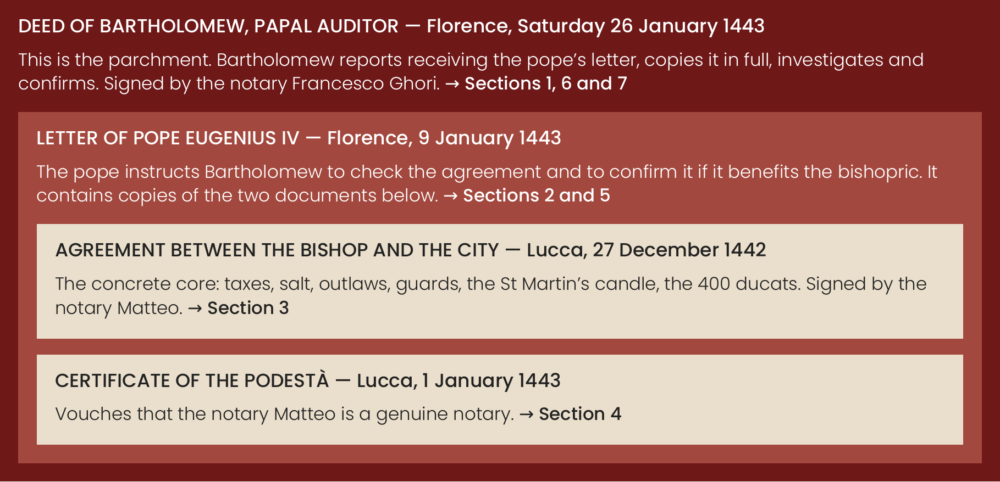
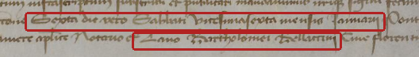
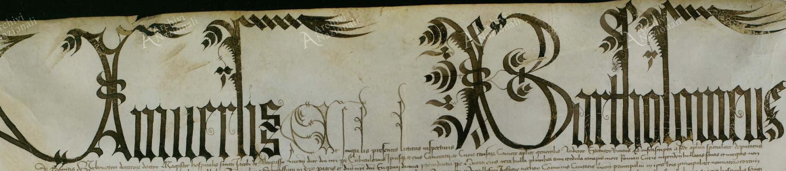
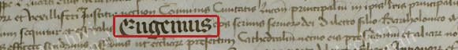
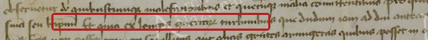
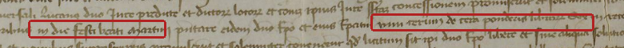
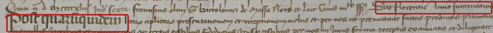
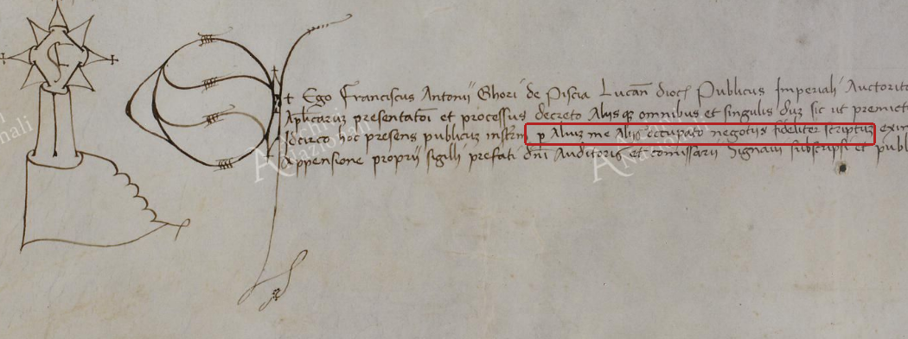
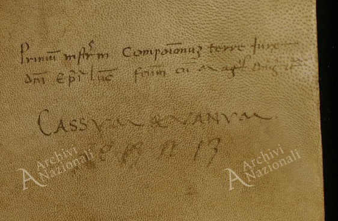

# Lucca, 1443

## I had an AI read a 1443 parchment with my surname on it

**Marco Bellaccini** · [bellaccini.it](https://bellaccini.it) · `marco.bellaccini(at!)gmail.com`

I recommend reading the [PDF version](parchment-1443-ai-en.pdf) of this article (it looks nicer).

Se cerchi la [versione italiana, è qui.](pergamena-1443-ai-it.md)

---

Hi, I'm Marco Bellaccini and I work in cybersecurity.

While I was trying out a new LLM, I remembered something I'd been curious about a few months earlier. I had searched for my surname on the Italian State Archives portal: just like that, to see what came up. That's how I'd found a fifteenth-century parchment kept in Lucca. The catalogue entry, a very short one, described some business between the city of Lucca and its bishop, with the pope involved. The parchment has been digitised and anyone can look at it online:

**[The parchment on the Archivi Nazionali portal](https://archivinazionali.cultura.gov.it/it/unita-documentaria/-/ud/view/17943555)**

I tried to find where my surname appeared and work out what it said. No luck: I'm not a palaeographer, I'm not an archivist, I do something else entirely for a living. My Latin is the little I remember from school and, clearly, it isn't enough to read the parchment. On top of that, I find the handwriting on the parchment damn hard to read.

So I thought: what if I had the AI read it?
I know perfectly well that plenty of people around the world have already done this kind of thing, and done it better. I did it out of personal curiosity.

I fed the parchment to Claude (using a mix of Opus 5.5 and Fable 5.2) and asked it to read it, translate it and explain it to me.

What came out is a story I find interesting in its own right, and I'm sharing it here.

Let me be clear about one thing up front: **I am not able to judge this work**. I don't have the tools. From the little I could check, what the AI wrote doesn't look crazy. It could also be well-packaged nonsense, and I could have been naive to trust it. If you work in this field and feel like telling me how things really stand, you can find me at [bellaccini.it](https://bellaccini.it). You can also email me at: `marco.bellaccini(at!)gmail.com`.

> **Transparency.** The reading of the parchment, the translation, the commentary and the source research are the AI's. So is this post: I dictated it out loud, with the story and the tone I wanted, and the AI wrote it up. No specialist has reviewed any of it.

## In short

- It is a deed dated **26 January 1443**, drawn up in Florence: a papal delegate confirms an agreement between the bishop of Lucca and the city's government.
- The agreement is about the **Jura**, the lands north of Lucca where the bishop was also the secular lord: taxes, salt, outlaws, guards, and a candle to be offered every year on St Martin's Day.
- My surname appears exactly once, at the very end: a certain **Lano (?) di Bartolomeo Bellaccini, citizen of Florence**, is one of the two witnesses.
- According to the AI, the **online catalogue contains a couple of slips**. In one case, though, it was the AI that got it wrong, and a second reading corrected it.
- Further down you will find **the whole text translated into modern English**, section by section, with explanations.

## The story, in two minutes

We are in Lucca in the early 1440s. The city is coming out of a decade of war: Florence besieged it in 1429, and peace came only in 1438. The treasury is empty. North of the city, along the Serchio river, between Moriano and Diecimo, the bishop is not just the religious leader but the secular lord. That territory is called the bishop's "Jura", and there he rules.

On 27 December 1442, Bishop Baldassarre Manni and the government of Lucca (the Elders, or *Anziani*, and the Standard-bearer of Justice, or *Gonfaloniere di giustizia*) sign an agreement. The bishop lets the Republic levy the same taxes in his lands as in the rest of its countryside: on bread, wine, oil and meat, on sales, on dowries and on wills. He also grants it the salt tax.

In return the city offers him a wax candle every year on St Martin's Day, exempts him from tolls on his provisions, sells him salt at less than half price, lends him guards and writes off a disputed debt of 400 gold ducats.

An agreement touching the rights of the Church, however, needs the pope. In those years Eugenius IV is living not in Rome but in Florence. On 9 January 1443 he instructs a trusted prelate, Bartholomew, master of the hospital of Altopascio and a judge of the Apostolic Chamber, to check that the deal is good for the bishopric and, if so, to confirm it. On Saturday 26 January 1443, at his house in Florence, Bartholomew confirms it. The parchment is the official record of that confirmation.

## Russian dolls, and two calendars

The parchment works like a set of Russian dolls. Bartholomew has the pope's letter copied into it, and the letter in turn contains a copy of the Lucca agreement and of a certificate from the city's chief magistrate.

Each document has its own date, and here there is a trap the AI spotted on its own: not everyone counted years the same way. In Lucca, and in Bartholomew's deed, the year began at Christmas. The pope's letter instead uses the "Incarnation" reckoning, in which the year begins on 25 March, as it did in Florence. That is why a letter written in January 1443 is dated "1442". Without that key, the dates would look wrong.

| Date (modern) | Place | What | Year as written in the document |
|---|---|---|---|
| 27 December 1442 | Lucca | Agreement between bishop and city | 1443 (year starts at Christmas) |
| 1 January 1443 | Lucca | The podestà vouches for the notary | 1443 |
| 9 January 1443 | Florence | Letter of Pope Eugenius IV | 1442 (year starts on 25 March) |
| 26 January 1443 | Florence | Bartholomew's confirmation (a Saturday) | 1443 |

## My surname

Here it is, at the foot of the deed, in the list of witnesses.

*In the red boxes (added by the AI): above, the date, "die vero Sabbati vicesimasexta mensis Januarii"; below, the witness's name, "Lano [?] Bartholomei Bellaccini".*

The transcription is the AI's, with the abbreviations expanded:

> *…Presentibus ibidem discretis et honestis viris Magistro Philippo quondam Lemmi de Piscia, Curie causarum Camere apostolice Notario, et Lano [?] Bartholomei Bellaccini, Cive florentino, testibus ad premissa vocatis specialiter et rogatis.*

That is: present, as witnesses specially summoned, were Master Filippo, son of the late Lemmo, of Pescia, notary of the court of the Apostolic Chamber, and Lano (?) di Bartolomeo Bellaccini, citizen of Florence.

That's all. My namesake plays no part in the substance: he was there to vouch that the deed was valid. A few clarifications:

- **The first name** ends in "-ano". The initial is uncertain: I explain why further down.
- **"Bartholomei"** means "son of Bartolomeo": it is the father's name.
- **"Bellaccini"** may already be a surname. But in fifteenth-century Florence the third element was often the grandfather's name ("son of Bellaccino"), which later hardened into a surname.

Whether he is an ancestor of mine I don't know, and this document doesn't say.

## Where the AI contradicts the catalogue (and where it got things wrong itself)

Reading the parchment, the AI disagrees with the online catalogue entry on three points.

**Orvieto, not Civitavecchia.** The entry calls the author of the deed "Bartolomeo Bonizzi da Civitavecchia". On the parchment the AI reads *de Urbeveteri*, and *Urbs Vetus* is the Latin name of Orvieto. Perhaps the cataloguer translated it literally as "old city" (*città vecchia*). The surname, on the other hand, is partly hidden by the decoration and remains uncertain (the AI suggests "de Bonitis").

**A title mistaken for a name.** The entry lists a witness called "Matteo Filippo quondam Lemmo da Pescia". The AI reads *Mag(ist)ro Philippo*, "Master Filippo": the abbreviation for *magistro* may have been taken for a first name.

**The second witness, that is, mine.** Here the entry does not even agree with itself: one field has "Lamo di Bartolomeo Bellomni", another "ano di Bartolomeo Bellaccini". The AI reads "Lano di Bartolomeo Bellaccini". The third letter of the first name has two strokes (an *n*), not three (an *m*), and the surname is the one in the second field.

On the initial, though, it was the AI that got it wrong first. The first model had read "Iano" or "Zano" and dismissed the catalogue's "L" as unlikely. The second model compared that letter with the other capital *L*s by the same scribe (in "Laurentio", for instance) and concluded that the shape is the same. So on the initial, the catalogue was right. A *Z* remains possible, but less likely.

If the AI is right, the catalogue contains a few slips. If it is wrong, it is the AI that is confidently making things up. The third point shows that both things happen. I have no way of telling which is which, and that is exactly the question I am putting to people who know.

## The full text, translated and explained

The parchment is long: about ninety dense lines of Latin, full of abbreviations. All of it is below, in the original order.

How to read it:

- The text **indented with a bar on the left** is the translation of the document.
- The **"Background"** paragraphs are added explanations and are not part of the document.
- **[?]** marks an uncertain reading of the preceding word.
- **[…]** and words **[in square brackets]** are passages not read, summarised, or added for clarity.
- The section headings were added by the AI: the document has none, it is a single block of text.

A note on the English: the AI read the Latin and translated it into Italian first; this English version was made from that Italian, with the Latin readings at hand. It is a fluent translation, not a word-for-word one. Notarial Latin repeats itself endlessly ("the aforesaid", "the above-mentioned") and piles up synonyms to leave no loopholes ("granted, ceded, transferred and entrusted"). Where the repetitions add nothing they have been lightened.

### 1. Bartholomew introduces himself

*The first line opens with large decorated letters ("Universis… Bartholomeus"), which give the deed its solemnity.*

> To each and every one who shall read this letter, Bartholomew de Bonitis [?] of Orvieto, doctor of canon law, master of the hospital of San Jacopo at Altopascio in the diocese of Lucca, chamberlain of our lord the pope and auditor general of his Chamber and of the court of the Apostolic Chamber, appointed by the Apostolic See as sole executor of what follows: everlasting salvation in the Lord, and full faith in what is written here.
>
> Know that we have received, with due reverence, an apostolic letter of the most holy father in Christ and our lord Eugenius IV, pope by divine providence. The letter bears his true leaden seal, hanging from a hemp cord after the custom of the Roman Curia; it is sound and whole, not damaged, not struck through, not suspect in any part and wholly free of defect. It was presented to us, before the notary and the witnesses named below, by the magnificent and mighty lords the Elders and the Standard-bearer of Justice and the Commune of the city of Lucca, who are the principal parties named in the letter. Its text, word for word, is this:

**Background**

- **Who Bartholomew is.** A senior prelate of the papal court. He is a "doctor of decrees", that is, a graduate in Church law. He runs the hospital of Altopascio, a great institution for the care of pilgrims on the Via Francigena. And he is an "auditor", that is, a judge of a papal court. Here he acts as "executor": the pope has given him a specific task and he reports on it.
- **The seal.** The word "bull" originally meant not the document but the lead seal (*bulla*) that closed it. That it hangs from hemp rather than silk is not a throwaway detail: in the papal chancery, hemp was used for orders and mandates, silk for grants of favour. Bartholomew stresses that the letter is intact because everything he is about to do depends on its being genuine.

### 2. The letter of Pope Eugenius IV

*"Eugenius episcopus servus servorum Dei": "Eugenius, bishop, servant of the servants of God", the formula that opens every papal letter.*

> Eugenius, bishop, servant of the servants of God, to his beloved son Bartholomew, master of the hospital of San Jacopo at Altopascio in the diocese of Lucca and auditor general of the court of the Apostolic Chamber: greeting and apostolic blessing.
>
> Called by divine disposition to the see of Peter, we strive to provide for the condition and the interests of churches, especially cathedral churches, of those who preside over them and of other persons devoted to us and to the Apostolic See. And when we are asked, we gladly add the strength of apostolic protection to what has been done to that end, so that it may stand unimpaired.
>
> A petition was lately presented to us on behalf of our beloved sons the Elders, the Standard-bearer of Justice and the Commune of Lucca. It stated that our venerable brother Baldassarre, bishop of Lucca, carefully considered the following: the men of the communities of Diecimo, San Leonardo di Aquilea, Pieve di Sesto di Moriano, Santo Stefano di Moriano, San Cassiano di Moriano, San Lorenzo di Moriano, San Michele di Villorbana and San Quirico di Laterano [?] are subjects of the bishop of Lucca in temporal matters too. For a long time they were oppressed by the whirlwinds of war and bore all manner of burdens for the government and defence of the territory, burdens that weighed on the bishop as well; moreover, because those lands were free [of the city's taxes], many scandals had arisen. For this reason the bishop made certain concessions and entered into agreements with the Elders, the Standard-bearer and the Commune, as is set out in full in the notarial deed which we have had copied below word for word.
>
> The Elders, the Standard-bearer and the Commune have therefore humbly asked us to strengthen these concessions, conventions and pacts with apostolic confirmation, so that they may rest on firmer ground, and otherwise to provide as is fitting.
>
> We, however, have no certain knowledge of these matters. Granting the petition, we order you by this letter to inform yourself carefully, by our authority, about all of this and every circumstance. If your inquiry shows that the concessions, conventions and pacts are to the evident advantage of the episcopal *mensa* of Lucca (and on this we charge your conscience), approve and confirm them by apostolic authority, together with all that has followed from them, making good any defect there may be. The text of the deed is this:

**Background**

- **The pope does not sign blind.** Eugenius IV does not confirm the agreement directly: he says he does not know the facts and delegates a trusted man to check them. There is one condition: the agreement must benefit the "episcopal *mensa*", the endowment that supports the bishop and his church. Church property could not be signed away freely; oversight from above was required. The phrase "we charge your conscience" makes Bartholomew personally answerable, before God, for his judgement.
- **The "Jura".** The territory north of Lucca, along the Serchio, where the bishop was also secular lord: there he collected, judged and governed, not the Commune. The name comes from the Latin *iura*, "rights".
- **Eight villages.** Diecimo lies furthest upstream; the other seven cluster around Moriano, closer to the city. Almost all still exist as parishes under the same names. "San Michele di Villorbana" and "San Quirico di Laterano" are in all likelihood today's San Michele and San Quirico di Moriano.

### 3. The Lucca agreement (27 December 1442)

Here begins the copy of the notarial deed by which, a month earlier, the bishop and the government of Lucca had come to terms. It is the longest and most concrete part.

#### 3.1 The parties and the reason

> In the name of God, auspiciously, amen. It befits a kindly father to share with wise compassion in the needs of his children. Therefore the reverend father in Christ and lord Baldassarre Manni of Lucca, by the grace of God and of the Apostolic See bishop of Lucca, has taken fatherly pity on the community of Lucca. Every day it is forced to bear heavy expenses on account of the many and various turns of human affairs; and were it not helped, for all the most diligent government of the republic, the whole city with its countryside and district would fall into ruin.
>
> The bishop has therefore come to the following settlement and pacts with the magnificent and mighty lords the Elders and the Standard-bearer of Justice of the people and Commune of Lucca: Lorenzo Buonvisi, Standard-bearer of Justice, and the Elders in office, Jacopo Tomasini, Paolo Loteri [?], ser Stefano Martini, Niccolò di ser Federigo, Piero da Ghivizzano [?], Giovanni Sbarra [?], Michele Provenzali [?], Jacopo Berti [?] and Baldassarre Benettoni [?]. For greater security, the Elders had put the matter to a vote among themselves "with boxes and balls", as is the custom under the statutes, and had approved it by secret ballot with no one dissenting.
>
> The purpose is to avoid the dissensions and scandals that in times past often arose between the bishops of Lucca and the government of the city on account of the Jura of Moriano and of Diecimo, and which had already brought losses, scandals and ruin.
>
> The communities of Diecimo, San Leonardo di Aquilea, Pieve di Sesto di Moriano, Santo Stefano di Moriano, San Cassiano di Moriano, San Lorenzo di Moriano, San Michele di Villorbana and San Quirico di Laterano [?], known as the "communities of the Jura of the lord bishop of Lucca", belong by full right to the bishopric of Lucca. Their men are the bishop's faithful subjects, and he is their temporal lord, called to govern them and do justice. No one else has jurisdiction over those places and those men; no one may trouble them or impose or exact from them tolls, compulsory services or duties, save the bishop himself, who is their true and free lord.
>
> Nevertheless, so that the city may be relieved of its burdens [uncertain reading], the bishop, in the name of these communities, by this public instrument grants, cedes, transfers and entrusts to the Elders and the Standard-bearer, present and accepting on behalf of the Commune of Lucca, the right and full power to collect the following.

**Background**

- **Boxes and balls.** Votes were cast by dropping a ball into a container: one colour for yes, one for no. It was how the Tuscan republics voted in secret. The notary mentions it to show that the decision was taken properly and unanimously.
- **A bishop giving something up.** The tone is that of a generous father helping a city in difficulty. But before conceding anything, the bishop insists that the Jura is his and his alone. He grants the use of certain rights, not ownership.

#### 3.2 Taxes on consumption: bread, wine, oil, meat

> [The Commune may collect] in the Jura and in each of its communities the duties and revenues on bread, wine, oil and meat sold at retail or butchered, throughout the territory of the Jura and within its boundaries: that is, in the whole territory of Diecimo and in the other places of the Jura of the bishopric, in the same manner and measure as they are collected in the Six Miles of the Lucchese countryside.
>
> This, however, is expressly reserved: the men of the Jura may kill and butcher in the Jura pigs, oxen, cows and heifers, whether born there or bought elsewhere, to salt the meat for their own consumption. They may also kill calves, wethers, lambs, kids and any other animal for the feast that each community holds once a year, for weddings, for any banquet, for funerals and for the "sevenths". Each for himself, his family and his guests, without sharing the meat with others or passing on any part of it in any way. Kids for their own consumption they may kill at any time, again without paying duty. Meat may be shared with others of the community only on feast days, and not otherwise; if they butcher in any other way, they must pay the duty. [A sentence follows on the sale of meat salted for their own use, which was not read with confidence.]
>
> In all these cases, however, to kill or butcher they must ask leave of the bishop, his vicar general or his viscount; and that leave must be signed both by one of them and by the officers of the Chief Excise (*Maggior Gabella*) of Lucca.

**Background**

- **Why so much fuss about meat?** Duties on consumption were among the main revenues of medieval cities. They were paid when goods were sold or animals butchered. The exemption for household use protects the peasant economy: the pig killed in winter and salted for the year, the lamb for the village feast, the wedding dinner.
- **The "sevenths".** The religious services held seven days after a death, often followed by a family meal.
- **The Six Miles.** The belt of territory within roughly six miles of Lucca's walls, administered separately from the rest of the countryside, which was divided into "vicariates". "As in the Six Miles" means bringing the Jura into line with the rules of the countryside nearest the city.
- **Leave with two signatures.** A neat compromise: the bishop remains lord, but the Commune's tax office keeps watch.

#### 3.3 Contracts, dowries and wills

> Further, [the Commune may collect] in the Jura the duties on sales, on other transfers of property, on dowries and on wills, in the same way as they are collected in the territory of Lucca, from anyone and on any property: both for contracts made in the Jura concerning property located elsewhere, and for contracts made in the city or countryside concerning property located in the Jura.
>
> There is, however, an exception. If the inhabitants of the Jura, or those permanently resident there, contract among themselves in the Jura over property located in the Jura, they pay no duty. Likewise, if a man of the Jura contracts in the Jura with an outsider over property located there, he pays no duty on his own share. The same holds if a man of the Jura leaves an inheritance or a legacy to another of the Jura: no duty is paid, provided the will was made there and the property is located there.

**Background.** This is the ancestor of today's stamp duty and inheritance tax. The rule is simple: as long as everything (people, property and the place of the contract) stays inside the Jura, the Commune takes nothing. Only what leaves the circle pays.

#### 3.4 Who judges fraud

> The hearing and punishment of those who commit fraud in these matters shall belong jointly, together and at once, to the bishop (or his vicar general or his viscount) and to the officers of the Chief Excise. The proceeds of fines for fraud shall go half to the bishop's Chamber and half to the Chamber of the Commune of Lucca.

**Background.** Judgement is joint and fines are split down the middle: neither side can use fraud cases to enrich itself at the other's expense. The "Chamber" is the treasury: the bishop's and the Commune's.

#### 3.5 The bishop's condition: no double taxation

> The bishop made this grant of the duties on one condition, held and understood "at the beginning, in the middle and at the end" of this contract. The men of the Jura, and in particular those of Diecimo, in paying duties on all goods they carry into or out of the countryside and district of Lucca, must be treated in all respects like the inhabitants of the vicariate of Coreglia [?]. The men of the other communities of the Jura must be treated like those of the Six Miles. They may not be compelled to pay in any other way, nor may anything else be demanded of them or imposed on them.
>
> An exception is made for slaughter animals they bring into the Jura from or through the countryside of Lucca: on these they shall pay duty at the time of transit, in the same amount as would be due if the animals were butchered in the Six Miles or in the vicariates they come from. Slaughter animals, however, do not include oxen broken in and fit for work, which they bring from the vicariates or the Six Miles to Diecimo or the other places of the Jura in order to work; nor is duty paid on animals taken to the Six Miles to graze, nor on bringing them back. Finally, slaughter animals do not include the pigs, oxen, cows and calves brought into the Jura to be salted for their own consumption.

**Background.** This is the quid pro quo: the bishop grants the taxes, but secures that his subjects pay no more than people in the neighbouring countryside. The distinction follows geography. Diecimo, further upstream, is put on a par with a vicariate of the Serchio valley; the Moriano villages, near the city, with the Six Miles. Working oxen and grazing stock are tools of the trade, not merchandise, which is why they stay exempt.

#### 3.6 Salt

> Further, the bishop ceded and granted to the Elders and the Commune of Lucca the right to impose on the men and communities of the Jura the salt levy, at the price of forty-five *bolognini* per *staio*, for a total of twenty *staia* of salt allotted according to the distribution made by the office of the Salt Customs, which is this:

| Community | Allotted quota |
|---|---|
| Diecimo | 6 staia and 2 quarre |
| Pieve di Sesto di Moriano | 3 staia and 2 saggioli |
| San Leonardo di Aquilea | 3 staia, 3 quarre and 2 saggioli |
| Santo Stefano di Moriano | 1 staio, 3 quarre and 2 saggioli |
| San Cassiano di Moriano | 3 quarre and 2 saggioli |
| San Quirico di Laterano [?] | 2 quarre and 2 saggioli |
| San Lorenzo di Moriano | 1 staio and 1 quarra |
| San Michele di Villorbana | 1 staio, 3 quarre and 2 saggioli |
| **Total** | **20 staia** (if 1 staio = 4 quarre = 16 saggioli) |

> The salt shall be paid for in the same ways and at the same times as in the countryside of Lucca. With this proviso: whenever the salt levy is lightened for the countryside or district of Lucca, it shall be lightened in proportion for the men of the Jura of Moriano and of Diecimo. Beyond the allotted quantity, the inhabitants of the Jura may buy the salt they need for themselves and their animals, at the same price and in the same way as the other inhabitants of the Six Miles, at Borgo di Moriano [?] or at any salt customs house of the countryside and district of Lucca, and nowhere else, as the inhabitants of the vicariates and the other subjects of the Commune do.
>
> The Elders further undertake to have the Customs of Lucca sell to the bishop the salt needed by him and his household at the price of twenty *bolognini* per *staio*.

**Background**

- **Compulsory salt.** In the Middle Ages salt was indispensable for preserving meat and cheese, and cities held the monopoly. Each community often had to buy a fixed amount a year whether it used it or not: in effect, a tax. The *staio* was a measure of capacity for grain and salt; the *quarra* and *saggiolo* were fractions of it. The *bolognino* was a small silver coin.
- **Sums that add up.** The quotas in the table were read from tiny abbreviations, but there is a way to check them. If one *staio* is four *quarre* and one *quarra* is four *saggioli*, the eight quotas add up to exactly twenty *staia*, the total stated in the text. A caveat: that ratio between the measures is the AI's assumption, not something taken from a source. Still, so exact a match makes both the assumption and the reading likely.
- **A discount for the bishop.** Everyone else pays 45 *bolognini*, the bishop 20: less than half.

#### 3.7 Outlaws and wrongdoers

> Further, so that every occasion for crime may be removed, the bishop and the Elders and the Standard-bearer, in the name of the Commune, agreed as follows. All those banned and condemned by the Commune of Lucca for an offence against the person shall be held to be banned and condemned in the Jura as well. There they may be seized, arrested and held by the officers of the Commune, and anyone may strike at them to the extent the statutes of Lucca allow.
>
> And conversely: those banned and condemned for offences against the person by the court of the bishop, his vicar general or his viscount shall be held to be banned and condemned in the territory of the Commune of Lucca as well, and anyone may strike at them lawfully and with impunity under the statutes of Lucca. They may be seized and arrested by the officers of either party. Those captured in the Jura must be handed over to the bishop or his court freely, with no reward or fee for capture to be paid. For the bishop does not intend to bind himself, the bishopric or the lands of the Jura to pay rewards to those who capture outlaws, nor to observe the statutes of Lucca that deal with them.
>
> The same shall apply to all wrongdoers who have committed offences for which the statutes of Lucca prescribe a "penalty of blood", even if no trial has yet been opened against them and no sentence or ban pronounced.

**Background**

- **The ban.** An "outlaw" (*bandito*) was not any old brigand but someone who had been condemned and placed outside the protection of the law. Often anyone could kill or capture him, and the Commune paid a reward. The problem was obvious: a man condemned in Lucca fled a few miles, into the bishop's Jura, and was safe there. This clause closes the loophole in both directions. It is a kind of extradition agreement.
- **"Penalty of blood".** Corporal punishment or death, reserved for the gravest crimes.

#### 3.8 Guards for the bishop

*"Et quia ex longis guerrarum turbinibus…": "And since, through the long whirlwinds of war…".*

> And since, on account of the long whirlwinds of war that raged for so long, already in the time of his predecessors [?], in the territory of Lucca and in the Jura, the income and revenues of the bishop and bishopric of Lucca are so reduced that the bishop cannot keep guards or other men-at-arms to meet his needs and defend the episcopal rights, the Elders and the Standard-bearer have laid down this: the podestà of Lucca, or other officers of the Commune, at the request of the bishop, his viscount or another of his officers, shall be bound to supply him with up to ten of their constables and guards, and more if the bishop asks, at his discretion, without the bishop having to pay them. Only, within the territory of the Jura, they must be given bread and wine free of charge and in fitting measure.

**Background.** Lucca had come through a brutal decade: the Florentine siege of 1429, peace only in 1438. Here the bishop declares himself so impoverished that he cannot afford even a small police force, and the Commune lends him one. The *berrovieri* and *satellites* were the armed men in the service of magistrates: constables, more or less.

#### 3.9 Citizens of Lucca with land in the Jura

> The bishop, the Elders and the Standard-bearer also agreed on this. Citizens of Lucca who hold lands and possessions within the bounds of the Jura may not, on account of those lands, be taxed, troubled or disturbed in any way, they or their tenants, by the communities of the Jura or by their men and officers, whether directly or by roundabout means, nor by any device contrived against them. Save this: when land surveys are carried out, on that occasion the citizens or their tenants may be charged in the same way as the inhabitants of the Jura and anyone else; beyond that, in no way.

**Background.** Many well-off Lucchese owned fields and vineyards in the country, including in the Jura. The village communities could have made up their losses by taxing them locally. This clause prevents that, with the sole exception of the costs of surveying and registering land: a sort of land registry.

#### 3.10 What the bishop gets

*In the boxes: "in die festi beati Martini" and "unum cereum de cera…". The St Martin's candle.*

> Further, the Elders and the Standard-bearer, wishing to acknowledge the bishop as their pastor and as universal lord of the Jura and its places, in return for this grant solemnly promised the bishop, present and accepting for himself, the bishopric and his successors, to present to him every year, for ever, on the feast day of St Martin, a wax candle weighing six pounds [?].
>
> They also promised that the bishop may carry and have carried, freely and without paying duty, everything needed for his own keep and that of his household and his horses, from wherever it comes: whether to the country estates where he goes to stay, or to any other place he wishes, or into the city and the bishopric. Likewise he may take out of the city, free of duty, everything needed by him, his household and his horses, wherever he resides. And this in such a way that henceforth, at no time, may he be forbidden or hindered from bringing these things into or out of Lucca.
>
> Finally the Elders and the Standard-bearer, in the name of the Commune, fully released and absolved the bishop, present and accepting, from the sum of four hundred gold ducats [?] which they claimed he owed the Commune, and for which a financial office of the Commune [uncertain reading] had had a quantity of his grain sequestered. They annul and cancel every sequestration made on that account, declaring that they well know the bishop is not bound to pay that sum.

**Background**

- **The candle.** Six pounds is about two kilos: a substantial candle, not a treasure. Its value is symbolic. Offering a candle to one's lord each year, on the patron saint's day, was the medieval way of saying "we acknowledge that this is yours". St Martin is the patron of Lucca cathedral.
- **The real gain.** The candle is a symbol, but the cancellation of a 400-ducat debt and the release of the seized grain are real money. The ducat and the florin were gold coins of about three and a half grams, the most prized of their day. It is easy to see why the bishop found the deal worthwhile.

#### 3.11 Guarantees, signatures, witnesses

> The two parties promised one another, by solemn stipulation, to hold all this valid and firm for ever, whole and uncorrupted, and never to act against it, by themselves or through others, for any reason or pretext. The penalty is one hundred florins, payable each time the agreement is breached. As security the bishop pledges the property of the bishopric; the Elders and the Standard-bearer, for themselves and their successors, that of the Commune. And they asked me, Matteo, the undersigned notary, to draw up one or more public instruments of it.
>
> Done at Lucca, in the palace of the magnificent lords of Lucca, in the place called [name uncertain], in the district of San Pietro in Cortina [?], in the presence of the witnesses specially summoned: the venerable Jacopo di Piero of Siena [?], vicar general of the bishop; Enrico [surname uncertain], *primicerius* of the cathedral; Michele [surname uncertain], Stefano di Giovanni [?] and Bartolomeo di Michele, canons of Lucca; Gregorio Arrighi [?], doctor of laws; Michele, son of the late Gherardo Burlamacchi; and ser Cristoforo di Niccolò Turrettini [?], chief collector of the Commune of Lucca. In the year from the Nativity of the Lord 1443, sixth indiction, on the 27th day of December, in the twelfth year of the pontificate of the most holy father and lord Eugenius IV.
>
> I, Matteo, son of the late Giovanni [surname uncertain], citizen of Lucca, notary by imperial authority, ordinary judge and at present chancellor of the bishop, was present at all this, and being asked wrote it and made it public, and here subscribed with my customary sign and name.

**Background**

- **People who mattered.** The witnesses are not all churchmen. A Michele di Gherardo Burlamacchi, of one of Lucca's great merchant families, served several times in those years as Standard-bearer of Justice, that is, head of the government.
- **Christmas or New Year?** The deed is dated "1443" but belongs to 27 December 1442. This is not a mistake: in Lucca the year began at Christmas, so 27 December was already 1443.
- **The indiction.** A fifteen-year cycle used in dating since Roman times. It worked as a check: if year and indiction disagree, something is wrong. Here they agree.
- **Notary "by imperial authority".** Notaries drew their authority from the emperor or the pope: that was what made their deeds credible everywhere, even outside their own city.

### 4. The podestà vouches for the notary (1 January 1443)

> To all who shall see this letter. We, Niccolò Severini [?] of Siena [?], podestà of Lucca, attest and bear witness to the truth of this: ser Matteo, son of the late Giovanni, the notary who drew up the above instrument, was at the time of the contract, before and after, and still is, a good, authentic, lawful, public and trustworthy notary. He practises the notary's craft publicly and openly and draws up public instruments, contracts and the last wills of the dead; people have frequent recourse to him, and full and undoubted faith is placed in his writings. In witness whereof we have had this letter made and furnished with our seal. Given at Lucca, on the first day of January 1443, sixth indiction.
>
> I, Francesco, son of the late ser Bartolomeo of Massa, notary and citizen of Lucca, [chancellor of the podestà?], subscribed.

**Background.** The deed had to travel to Florence, to the pope, and no one there knew the notary Matteo. The podestà, Lucca's highest judicial authority, certifies that he is a real notary. It is the ancestor of the apostille that still accompanies documents sent abroad.

### 5. The date of the pope's letter (9 January 1443)

*On the right, "Dat. Florentie anno Incarnationis…": the date of the pope's letter. Below, with the large P, "Post quarumquidem…": from there Bartholomew speaks again.*

> Given at Florence, in the year of the Lord's Incarnation 1442, on the fifth day before the Ides of January, in the twelfth year of our pontificate.

**Background.** Three oddities in one line. "Given at Florence": in those years Eugenius IV lived in Florence, not Rome. "Year of the Incarnation 1442": here years are counted from 25 March, so January 1443 is still "1442". "The fifth day before the Ides": days are counted backwards in the Roman manner. The Ides of January fall on the 13th, and five days before, counting the 13th itself, is 9 January.

### 6. Bartholomew investigates and confirms

> After this apostolic letter had been presented to us and received by us as stated, [the Elders, the Standard-bearer and the Commune] produced before us, to inform us about all that the letter contains, certain documents and proofs and certain trustworthy witnesses. We received those witnesses, examined them in due form of law and questioned them carefully. Finally they pressed us to proceed to the execution of the apostolic letter in the form it prescribes.
>
> We therefore, Bartholomew, master, auditor and executor, judging the request just and reasonable and wishing to carry out with reverence, as we are bound, the apostolic mandate, have found, from the documents, from the depositions of the witnesses and from other information diligently gathered, that the concessions, conventions and pacts are to the evident advantage of the episcopal *mensa* of Lucca. Chiefly for these reasons: the Church of Lucca gains the acknowledgement of a right of lordship [?] and the obligation of an annual payment; it obtains the aid of men-at-arms to preserve its jurisdiction and administer justice; it obtains exemption from duties, which the bishop might otherwise have been bound to pay by custom; and it obtains an effective peace and union, for the future, between the bishop and the community of Lucca.
>
> For in the past many scandals and discords had often arisen between the bishop and the community, on account of which citizens and other benefactors, outsiders included, drew back from their devotion and ceased to lend their helping hand to the increase of divine worship. We have also found everything else stated in the apostolic letter to be true.
>
> Therefore, by the apostolic authority entrusted to us, we have approved and confirmed, and by this letter do approve and confirm, the concessions, conventions and pacts and everything contained in the apostolic letter and following from it, making good any defect there may have been. All this, the apostolic letter and these our proceedings, we communicate, notify and make known to each and all of you to whom they are addressed, jointly or severally, and we wish it to come to the knowledge of all.

**Background**

- **A real inquiry?** Bartholomew says he heard witnesses and examined documents. How thorough the inquiry was we cannot tell: seventeen days separate the pope's letter (9 January) from the confirmation (26 January). Either way, the reasons he lists are a good summary of what the bishop stood to gain.
- **The most human detail.** The last reason is a surprise: quarrels between bishop and city were making the faithful less generous. Peace with the Commune also meant better alms.

### 7. Seal, date, witnesses, notary

*The line with "die vero Sabbati vicesimasexta mensis Januarii" (Saturday 26 January) and, below, the witness "Lano [?] Bartholomei Bellaccini".*

> In faith and witness of all this we have had this letter drawn up, that is, this public instrument containing our proceedings, and have had it subscribed and published by the undersigned notary and furnished with our seal. Given and done at Florence, in the house where we dwell, in the year from the Nativity of the Lord 1443, sixth indiction, on Saturday the 26th of January, in the twelfth year of the pontificate of our lord Pope Eugenius IV. Present, as witnesses specially summoned and asked, were the discreet and honest men Master Filippo, son of the late Lemmo, of Pescia, notary of the court of the Apostolic Chamber, and Lano [?] di Bartolomeo Bellaccini, citizen of Florence.

*The notary's sign (left) and his subscription. In the box: "per alium, me aliis occupato negotiis, fideliter scriptum".*

> And I, Francesco di Antonio Ghori of Pescia, of the diocese of Lucca, notary by imperial authority and notary and scribe of the court of the Apostolic Chamber, was present with the witnesses named above at the presentation of the apostolic letter, the proceedings, the decision and all the rest, as it took place in the manner described; I saw and heard it so done. I therefore drew up this public instrument, faithfully written by another because I was busy with other matters; I subscribed it, published it and put it into this public form, and signed it with my customary sign and name, together with the seal of the auditor and commissary, being asked, in faith and witness of all the foregoing.

**Background**

- **The Florentine witness.** What is certain is the father's name, Bartolomeo, and the description "citizen of Florence". The surname "Bellaccini" is the most likely reading and matches one of the fields in the catalogue entry. The first name ends in "-ano"; the initial has the same shape as the scribe's capital *L*s, hence "Lano", a Tuscan name of the period. A *Z* ("Zano", from Zanobi) cannot be ruled out.
- **The notary's sign.** At bottom left there is a drawing shaped like a tower. Every notary had his own, always the same, and drew it by hand: it was his unmistakable signature, harder to forge than a name.
- **"Written by another".** The notary admits, with almost modern candour, that he did not copy out the ninety lines himself: a scribe did, and he checked and signed (*per alium, me aliis occupato negotiis, fideliter scriptum*). He says so because the deed's validity rested on his presence and his signature, not on his hand.
- **A difference in style.** The notary's subscription is in a different hand, rounder and more regular than the rest. That is further confirmation that someone else wrote the body of the deed.

### 8. The back

*The back, with the archival notes.*

> First instrument of the settlements concerning the lands of the Jura of the lord bishop of Lucca, made with the magnificent lords [Elders?]. [Later archival shelfmarks follow, not read.]

**Background.** Archivists of every period wrote a short title on the back of folded parchments so as to find them without opening them. The word "first" suggests there were other deeds on the same matter.

## A short glossary

| Term | What it is |
|---|---|
| Anziani (Elders) | The members of the collegiate government of the Republic of Lucca, in office for short terms. |
| Ban, outlaw (*bando*, *bandito*) | The sentence that put a person outside the protection of the law; the person so condemned. |
| Bull (*bulla*) | The lead seal of papal letters; by extension, the letter itself. |
| Bolognino | A small silver coin. |
| Apostolic Chamber | The financial administration of the papacy, with its own court. |
| Contado | The countryside subject to a city. |
| Ducat, florin | Gold coins of about 3.5 grams, the most prized of the age. |
| Gabella | An indirect tax on consumption, goods and transfers of property. |
| Gonfaloniere di giustizia (Standard-bearer of Justice) | The head of the government of Lucca, presiding over the Elders. |
| Indiction | A fifteen-year cycle used in dates as a check. |
| Jura | The territory north of Lucca where the bishop was also secular lord. |
| Episcopal *mensa* | The endowment that supports the bishop and his church. |
| Podestà | The magistrate, usually an outsider, who administered justice in the city. |
| Six Miles (*Sei Miglia*) | The belt of territory closest to Lucca's walls, administered separately. |
| Signum (sign) | The personal drawing with which a notary authenticated his deeds. |
| Staio | A measure of capacity for grain and salt; the *quarra* and *saggiolo* were fractions of it. |
| Auditor | A judge of a court of the papal curia. |
| Vicariate (*vicaria*) | An administrative district of the Lucchese countryside. |
| Viscount | The officer who ran the bishop's temporal jurisdiction on his behalf. |

## What remains uncertain

In the interest of honesty, here are the points where the reading is weakest. They are where I would start if I wanted to check the work against the original.

- **Proper names.** Many names of the Elders, of the Lucca witnesses and of the podestà remain approximate readings. The same goes for Bartholomew's surname and the first name of the Florentine witness.
- **Figures.** The weight of the candle (six pounds) and the salt quotas held up on the second reading. The sum written off (four hundred ducats) is likely but needs checking.
- **Some technical passages.** The sentence on the sale of salted meat, the "Borgo" where salt is bought, the office that had seized the grain and the first of the reasons listed by Bartholomew were only partly read.
- **The source.** Everything was done from screenshots, not high-resolution images, and the portal's watermark covers a few letters here and there.
- **The second check was not exhaustive.** The second model re-read the key points from the screenshots (opening, village lists, names, salt, the Diecimo clause, candle, ducats, closing, podestà, date, witnesses, back). The clauses on contracts, outlaws, guards and citizen landowners it only compared against the first model's working transcription.

## Why I'm asking for an opinion

The work looks convincing to me: it is coherent, the dates add up, the historical picture holds together. But "convincing" is not the same as "correct". These systems produce plausible wrong readings in exactly the same confident tone as the right ones, and I watched it happen inside this very experiment.

So, if you are a palaeographer, an archivist, a historian, or simply someone who can actually do this, here are my questions:

1. Are the readings right, starting with the three points of disagreement with the catalogue?
2. Are the summary and the translation faithful, or is something important missing?
3. Can a tool like this be useful for a first reading or for catching errors in catalogues, or is it more likely to spread well-packaged mistakes?

The parchment is [freely viewable on the portal](https://archivinazionali.cultura.gov.it/it/unita-documentaria/-/ud/view/17943555). I would love to know whether I am holding a good piece of work or a well-dressed hallucination.

Let me know what you think. I'm Marco Bellaccini: my site is **[bellaccini.it](https://bellaccini.it)**, where you'll find all my contact details, and my email is `marco.bellaccini(at!)gmail.com`.

## The document and the sources

**The document.** State Archive of Lucca, Diplomatico, "Archivio di Stato – Tarpea", 26 January 1443 (formerly bundle no. 587); parchment, 490 × 750 mm.

**Images.** Cropped screenshots of the digital reproduction published on the Archivi Nazionali portal (Italian Ministry of Culture). The red boxes were added by the AI to highlight the passages discussed.

**Models used.** Claude Opus 5.5 (first reading, summary, translation and commentary) and Claude Fable 5.2 (recheck, corrections and the writing of this post), in November 2026, working from five screenshots of the digital reproduction.

**Sources for the historical background**

1. [Archivi Nazionali, catalogue entry for the document](https://archivinazionali.cultura.gov.it/it/unita-documentaria/-/ud/view/17943555)
2. [Catholic-Hierarchy, Bishop Baldassarre Manni (1441–1448)](https://catholic-hierarchy.org/bishop/bmannib.html)
3. [R. Savigni, Diecimo and the episcopal "Jura" of Lucca (University of Bologna)](https://cris.unibo.it/handle/11585/794883)
4. [Palazzo Ducale, Lucca: the 1429 siege and the 1438 peace](https://www.palazzoducale.lucca.it/en/node/370)
5. [University of Łódź, Florence and the War against Lucca (1429–1433)](https://press.uni.lodz.pl/index.php/wul/catalog/download/944/4653/2565?inline=1)
6. [University of Florence, the Collegio Eugeniano (Eugenius IV in Florence from 1434)](https://flore.unifi.it/retrieve/e398c37c-677f-179a-e053-3705fe0a4cff/Collegio%20Eugeniano%20con%20ISBN.pdf)
7. [Catholic Encyclopedia: Eugenius IV re-enters Rome, 28 September 1443](https://www.catholic.org/encyclopedia/view.php?id=4412)
8. [P. Ventrone, The Annunciation and the Florentine New Year (25 March)](https://www.storiadifirenze.org/pdf_ex_eprints/14-Ventrone.pdf)
9. [Wikipedia, Altopascio and its hospital](https://en.wikipedia.org/wiki/Altopascio)
10. [Wikipedia, Republic of Lucca (the Burlamacchi among the Gonfalonieri)](https://en.wikipedia.org/wiki/Republic_of_Lucca)
11. [Archdiocese of Lucca, list of parishes (Moriano area)](https://www.diocesilucca.it/wp-content/uploads/2020/06/decreto_comunit%e0_def.pdf)
