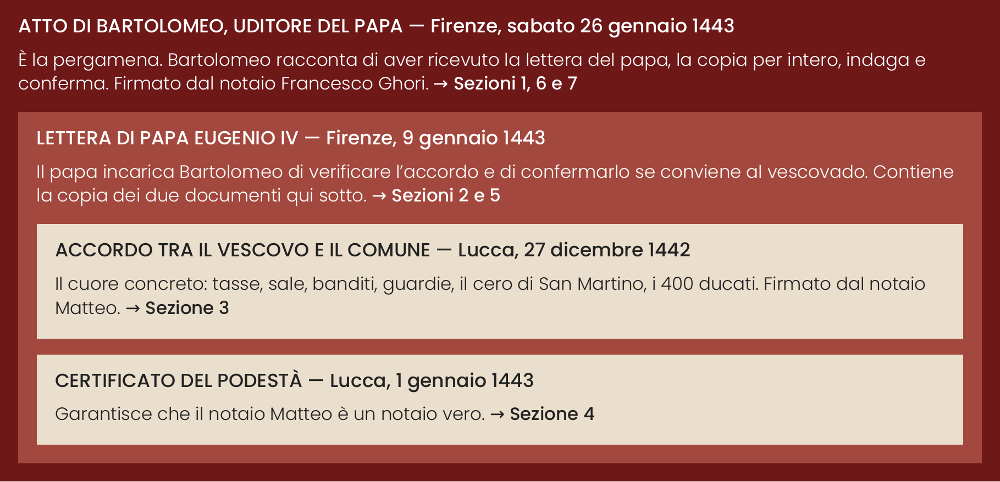
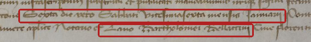
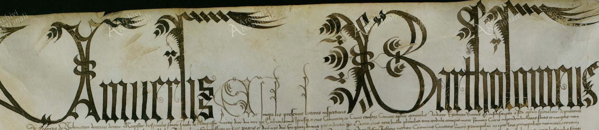
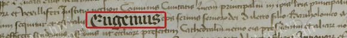
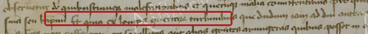
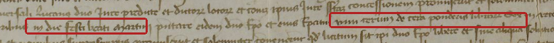
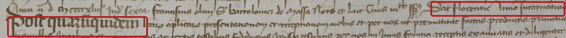
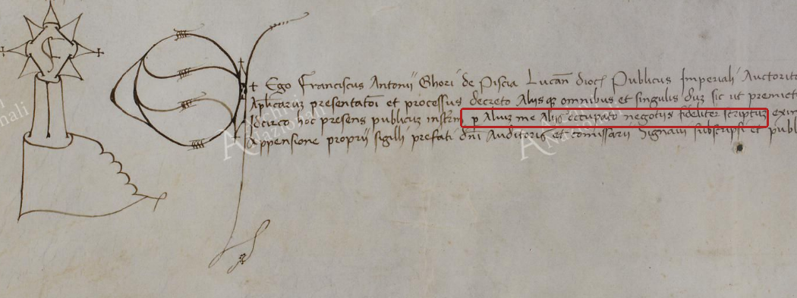
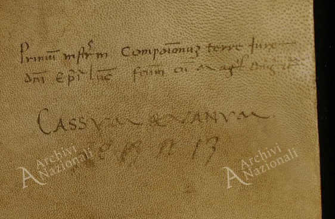

# Lucca, 1443

## Ho fatto leggere a un'AI una pergamena del 1443 in cui compare il mio cognome

**Marco Bellaccini** · [bellaccini.it](https://bellaccini.it) · `marco.bellaccini(at!)gmail.com`

Ti consiglio di leggere la [Versione PDF](pergamena-1443-ai-it.pdf) di questo articolo (è più carina).

If you're looking for the [English version, it's here.](parchment-1443-ai-en.md)

---

Ciao, sono Marco Bellaccini e mi occupo di sicurezza informatica.

Mentre stavo provando un nuovo LLM, mi è tornata in mente una curiosità che avevo avuto qualche mese prima. Avevo cercato il mio cognome sul portale degli Archivi di Stato italiani: così, per vedere cosa usciva. In quel modo, avevo trovato una pergamena del Quattrocento conservata a Lucca. La scheda, molto sintetica, parlava di una faccenda tra il Comune di Lucca e il vescovo, con il papa di mezzo. La pergamena è stata digitalizzata e si può guardare online:

**[La pergamena sul portale Archivi Nazionali](https://archivinazionali.cultura.gov.it/it/unita-documentaria/-/ud/view/17943555)**

Ho provato a cercare dove appariva il mio cognome e a capire cosa c'era scritto. Niente da fare: non sono un paleografo, non sono un archivista, nella vita faccio tutt'altro. Il mio latino è quel poco che mi ricordo dalle superiori e, chiaramente, non è sufficiente per leggere la pergamena. Oltretutto, trovo che i caratteri della pergamena siano dannatamente difficili da leggere.

A quel punto mi sono detto: e se provassi a farla leggere all'AI?
So benissimo che in giro per il mondo c'è chissà quanta gente che ha già fatto lavori del genere, e meglio di me. L'ho fatto per curiosità personale.

Ho dato la pergamena in pasto a Claude (usando un mix di Opus 5.5 e  Fable 5.2) e gli ho chiesto di leggerla, tradurmela e spiegarmela.

Quello che ne è uscito è una storia che trovo interessante di per sé, e la condivido qui.

Chiariamo bene una premessa: **io non sono in grado di valutare questo lavoro**. Non ho gli strumenti. Per quel poco che ho potuto controllare, quello che ha scritto l'AI non mi sembra una follia. Potrebbe anche essere una stupidaggine ben confezionata, e io potrei essermi fidato in modo ingenuo. Se sei un addetto ai lavori e hai voglia di dirmi come stanno le cose, mi trovi su [bellaccini.it](https://bellaccini.it). Puoi anche scrivermi a: `marco.bellaccini(at!)gmail.com`.

> **Trasparenza.** Lettura della pergamena, traduzione, commento e ricerca delle fonti sono dell'AI. Anche questo post: io l'ho dettato a voce, con la storia e il tono che volevo, e l'AI l'ha messo in bella. Nessuno specialista ha rivisto nulla.

## In breve

- È un atto del **26 gennaio 1443**, scritto a Firenze: un delegato del papa conferma un accordo tra il vescovo di Lucca e il governo della città.
- L'accordo riguarda la **Jura**, le terre a nord di Lucca dove il vescovo era anche signore: tasse, sale, banditi, guardie, e un cero da offrire ogni anno per San Martino.
- Il mio cognome compare una volta sola, in fondo: un certo **Lano (?) di Bartolomeo Bellaccini, cittadino fiorentino**, è uno dei due testimoni.
- Secondo l'AI il **catalogo online contiene un paio di sviste**. In un caso, però, a sbagliare era stata l'AI, e l'ha corretta una seconda rilettura.
- Più sotto c'è **tutto il testo tradotto in italiano di oggi**, sezione per sezione, con le spiegazioni.

## La storia, in due minuti

Siamo a Lucca all'inizio degli anni Quaranta del Quattrocento. La città esce da un decennio di guerre: Firenze l'ha assediata nel 1429 e la pace è arrivata solo nel 1438. Le casse sono vuote. A nord della città, lungo il Serchio, tra Moriano e Diecimo, il vescovo non è solo la guida religiosa ma anche il signore temporale. Quel territorio si chiama «Jura» del vescovo, e lì governa lui.

Il 27 dicembre 1442 il vescovo Baldassarre Manni e il governo di Lucca (gli Anziani e il Gonfaloniere di giustizia) firmano un accordo. Il vescovo concede alla Repubblica di riscuotere nelle sue terre le stesse tasse del resto del contado: su pane, vino, olio e carne, sulle vendite, sulle doti e sui testamenti. Le concede anche l'imposta sul sale.

In cambio il Comune gli offre ogni anno un cero di cera nel giorno di San Martino, lo esenta dai dazi sui viveri, gli vende il sale a meno di metà prezzo, gli presta le guardie e gli cancella un debito contestato di 400 ducati d'oro.

Un accordo che tocca i diritti della Chiesa, però, ha bisogno del papa. Eugenio IV in quegli anni non sta a Roma ma a Firenze. Il 9 gennaio 1443 incarica un prelato di fiducia, Bartolomeo, maestro dell'ospedale di Altopascio e giudice della Camera apostolica, di verificare che l'accordo convenga al vescovado e, se sì, di confermarlo. Sabato 26 gennaio 1443, a casa sua a Firenze, Bartolomeo lo conferma. La pergamena è il documento ufficiale di quella conferma.

## Una matrioska con due calendari

La pergamena funziona come una matrioska. Bartolomeo ci fa copiare dentro la lettera del papa, che a sua volta contiene la copia dell'accordo di Lucca e di un certificato del podestà.

Ogni documento ha la sua data, e qui c'è un'insidia che l'AI ha notato da sola: non tutti contavano gli anni allo stesso modo. A Lucca, e nell'atto di Bartolomeo, l'anno cominciava a Natale. La lettera del papa usa invece il computo «dell'Incarnazione», con l'anno che comincia il 25 marzo, come a Firenze. Per questo una lettera scritta nel gennaio 1443 porta la data «1442». Senza questa chiave le date sembrerebbero sbagliate.

| Data (oggi) | Luogo | Che cosa | Anno scritto nel documento |
|---|---|---|---|
| 27 dicembre 1442 | Lucca | Accordo tra vescovo e Comune | 1443 (l'anno parte da Natale) |
| 1 gennaio 1443 | Lucca | Il podestà garantisce per il notaio | 1443 |
| 9 gennaio 1443 | Firenze | Lettera di papa Eugenio IV | 1442 (l'anno parte dal 25 marzo) |
| 26 gennaio 1443 | Firenze | Conferma di Bartolomeo (sabato) | 1443 |

## Il mio cognome

Eccolo, in fondo all'atto, nell'elenco dei testimoni.

*Nei riquadri rossi (aggiunti dall'AI): sopra la data, «die vero Sabbati vicesimasexta mensis Januarii»; sotto il nome del testimone, «Lano [?] Bartholomei Bellaccini».*

La trascrizione è dell'AI, con le abbreviazioni sciolte:

> *…Presentibus ibidem discretis et honestis viris Magistro Philippo quondam Lemmi de Piscia, Curie causarum Camere apostolice Notario, et Lano [?] Bartholomei Bellaccini, Cive florentino, testibus ad premissa vocatis specialiter et rogatis.*

Cioè: erano presenti, come testimoni chiamati apposta, maestro Filippo del fu Lemmo da Pescia, notaio del tribunale della Camera apostolica, e Lano (?) di Bartolomeo Bellaccini, cittadino fiorentino.

Tutto qui. Il mio omonimo non ha nessun ruolo nella sostanza: era lì a garantire che l'atto fosse valido. Qualche precisazione:

- **Il nome di battesimo** finisce in «-ano». L'iniziale è incerta: più sotto racconto perché.
- **«Bartholomei»** vuol dire «di Bartolomeo»: è il nome del padre.
- **«Bellaccini»** può essere già un cognome. Ma nella Firenze del Quattrocento il terzo elemento era spesso il nome del nonno («di Bellaccino»), che poi diventava cognome.

Se sia un mio antenato non lo so, e questo documento non lo dice.

## Dove l'AI contraddice il catalogo (e dove ha sbagliato lei)

Leggendo la pergamena, l'AI non è d'accordo con la scheda online su tre punti.

**Orvieto, non Civitavecchia.** La scheda chiama l'autore dell'atto «Bartolomeo Bonizzi da Civitavecchia». Sulla pergamena l'AI legge *de Urbeveteri*, e *Urbs Vetus* è il nome latino di Orvieto. Forse chi ha schedato ha tradotto alla lettera «città vecchia». Il cognome invece è in parte coperto dalla decorazione e resta incerto (l'AI propone «de Bonitis»).

**Un titolo scambiato per un nome.** La scheda elenca un testimone «Matteo Filippo quondam Lemmo da Pescia». L'AI legge *Mag(ist)ro Philippo*, «maestro Filippo»: l'abbreviazione di *magistro* sarebbe stata presa per un nome.

**Il secondo testimone, cioè il mio.** Qui la scheda non è d'accordo nemmeno con se stessa: in un campo scrive «Lamo di Bartolomeo Bellomni», in un altro «ano di Bartolomeo Bellaccini». L'AI legge «Lano di Bartolomeo Bellaccini». La terza lettera del nome ha due gambe (una *n*), non tre (una *m*), e il cognome è quello del secondo campo.

Sull'iniziale, però, a sbagliare per prima è stata l'AI. Il primo modello aveva letto «Iano» o «Zano» e aveva liquidato la «L» del catalogo come improbabile. Il secondo modello ha confrontato quella lettera con le altre *L* maiuscole dello stesso scrivano (in «Laurentio», per esempio) e ha concluso che la forma è la stessa. Sull'iniziale, quindi, aveva ragione il catalogo. Una *Z* resta possibile, ma meno probabile.

Se l'AI ha ragione, il catalogo contiene qualche svista. Se ha torto, è l'AI a inventare con sicurezza. Il terzo punto dimostra che succedono tutte e due le cose. Io non ho modo di distinguere i due casi, ed è proprio questa la domanda che faccio a chi ne sa.

## Il testo completo, tradotto e spiegato

La pergamena è lunga: circa novanta righe fitte di latino, piene di abbreviazioni. Qui sotto c'è tutta, nell'ordine originale.

Come leggerla:

- Il testo **rientrato con la barra a sinistra** è la traduzione del documento.
- I paragrafi **«Per capire»** sono spiegazioni aggiunte, non fanno parte del documento.
- **[?]** segna una lettura incerta della parola precedente.
- **[…]** e le parole **[tra quadre]** sono passi non letti, riassunti o aggiunti per chiarezza.
- I titoli delle sezioni li ha aggiunti l'AI: nel documento non ci sono, è un unico blocco di testo.

La traduzione è scorrevole, non parola per parola. Il latino notarile ripete moltissimo («i predetti», «i suddetti») e accumula sinonimi per non lasciare scappatoie («concesse, cedette, trasferì e affidò»). Dove le ripetizioni non aggiungono nulla sono state alleggerite.

### 1. Bartolomeo si presenta

*La prima riga si apre con grandi lettere decorate («Universis… Bartholomeus»), che servono a dare solennità all'atto.*

> A tutti e a ciascuno di coloro che leggeranno questa lettera, Bartolomeo de Bonitis [?] di Orvieto, dottore in diritto canonico, maestro dell'ospedale di San Jacopo di Altopascio nella diocesi di Lucca, cameriere del nostro signore il papa e uditore generale della sua Camera e del tribunale della Camera apostolica, incaricato dalla Sede apostolica come unico esecutore di quanto segue: salute eterna nel Signore, e piena fede a quanto qui scritto.
>
> Sappiate che abbiamo ricevuto, con il rispetto dovuto, una lettera apostolica del santissimo padre in Cristo e nostro signore Eugenio IV, papa per provvidenza divina. La lettera porta la sua vera bolla di piombo, appesa con una cordicella di canapa secondo l'uso della Curia romana; è sana e integra, non rovinata, non cancellata, non sospetta in nessuna parte e del tutto priva di difetti. Ce l'hanno presentata, davanti al notaio e ai testimoni nominati più sotto, i magnifici e potenti signori Anziani e Gonfaloniere di giustizia e il Comune della città di Lucca, che sono i destinatari principali della lettera stessa. Il suo testo, parola per parola, è questo:

**Per capire**

- **Chi è Bartolomeo.** Un alto prelato della corte papale. È «dottore in decreti», cioè laureato in diritto della Chiesa. Dirige l'ospedale di Altopascio, una grande istituzione per l'assistenza ai pellegrini sulla via Francigena. Ed è «uditore», cioè giudice di un tribunale papale. Qui agisce come «esecutore»: il papa gli ha affidato un compito preciso e lui ne rende conto.
- **La bolla.** In origine «bolla» non è il documento, ma il sigillo di piombo che lo chiudeva. Che penda da un filo di canapa e non di seta non è un dettaglio: nella cancelleria papale la canapa si usava per gli ordini e i mandati, la seta per le concessioni di grazia. Bartolomeo insiste sul fatto che la lettera è intatta perché tutto quello che farà dipende dalla sua autenticità.

### 2. La lettera di papa Eugenio IV

*«Eugenius episcopus servus servorum Dei»: «Eugenio vescovo, servo dei servi di Dio», la formula che apre ogni lettera papale.*

> Eugenio vescovo, servo dei servi di Dio, al diletto figlio Bartolomeo, maestro dell'ospedale di San Jacopo di Altopascio nella diocesi di Lucca e uditore generale del tribunale della Camera apostolica: salute e benedizione apostolica.
>
> Chiamati per disposizione divina alla sede di Pietro, ci sforziamo di provvedere alla condizione e agli interessi delle chiese, soprattutto delle cattedrali, di chi le guida e delle altre persone devote a noi e alla Sede apostolica. E quando ci viene chiesto, aggiungiamo volentieri la forza della protezione apostolica a ciò che è stato fatto a questo scopo, perché resti intatto.
>
> Ci è stata presentata da poco una supplica da parte dei diletti figli Anziani, Gonfaloniere di giustizia e Comune di Lucca. Vi si diceva che il venerabile fratello Baldassarre, vescovo di Lucca, ha considerato con attenzione questa situazione: gli uomini delle comunità di Diecimo, San Leonardo di Aquilea, Pieve di Sesto di Moriano, Santo Stefano di Moriano, San Cassiano di Moriano, San Lorenzo di Moriano, San Michele di Villorbana e San Quirico di Laterano [?] sono sudditi del vescovo di Lucca anche nelle cose temporali. Per molto tempo sono stati oppressi dai turbini delle guerre e hanno sostenuto spese di ogni genere per il governo e la difesa del territorio, spese che pesavano anche sul vescovo; inoltre, poiché quelle terre erano libere [dalle imposte della città], erano nati molti scandali. Per questo il vescovo ha fatto alcune concessioni e ha stretto patti con gli Anziani, il Gonfaloniere e il Comune, come si legge per esteso nell'atto notarile che abbiamo fatto copiare qui sotto parola per parola.
>
> Gli Anziani, il Gonfaloniere e il Comune ci hanno quindi umilmente chiesto di rafforzare con la conferma apostolica queste concessioni, convenzioni e patti, perché abbiano una base più solida, e di provvedere in altro modo come opportuno.
>
> Noi però non abbiamo una conoscenza sicura di questi fatti. Accogliendo la supplica, ti ordiniamo con questa lettera di informarti con cura, per nostra autorità, su tutto quanto e su ogni circostanza. Se dall'indagine risulterà che le concessioni, le convenzioni e i patti vanno a evidente vantaggio della mensa vescovile di Lucca (e su questo ti carichiamo la coscienza), approvali e confermali con autorità apostolica, insieme a tutto ciò che ne è seguito, rimediando a ogni eventuale difetto. Il testo dell'atto è questo:

**Per capire**

- **Il papa non firma alla cieca.** Eugenio IV non conferma direttamente l'accordo: dice di non conoscere i fatti e delega un uomo di fiducia a verificarli. La condizione è una sola: l'accordo deve convenire alla «mensa vescovile», cioè al patrimonio che mantiene il vescovo e la sua chiesa. I beni della Chiesa non si potevano cedere liberamente, serviva un controllo dall'alto. La formula «ti carichiamo la coscienza» rende Bartolomeo personalmente responsabile, davanti a Dio, del suo giudizio.
- **La «Jura».** È il territorio a nord di Lucca, lungo il Serchio, in cui il vescovo era anche signore temporale: lì riscuoteva, giudicava e governava lui, non il Comune. Il nome viene dal latino *iura*, «diritti».
- **Otto villaggi.** Diecimo è il più a monte; gli altri sette stanno intorno a Moriano, più vicino alla città. Quasi tutti esistono ancora come parrocchie con lo stesso nome. «San Michele di Villorbana» e «San Quirico di Laterano» sono con ogni probabilità le odierne San Michele e San Quirico di Moriano.

### 3. L'accordo di Lucca (27 dicembre 1442)

Qui comincia la copia dell'atto notarile con cui, un mese prima, il vescovo e il governo di Lucca si erano accordati. È la parte più lunga e più concreta.

#### 3.1 Le parti e il motivo

> Nel nome di Dio, felicemente, amen. A un padre benevolo si addice partecipare con saggia pietà alle necessità dei figli. Per questo il reverendo padre in Cristo e signore Baldassarre Manni da Lucca, per grazia di Dio e della Sede apostolica vescovo di Lucca, ha avuto pietà paterna della comunità di Lucca. Ogni giorno essa deve sostenere spese pesanti per i molti e vari casi della vita; e se non la si aiutasse, nonostante il governo diligentissimo della repubblica, l'intera città con il suo contado e il suo distretto andrebbe in rovina.
>
> Il vescovo è quindi giunto all'accordo e ai patti che seguono con i magnifici e potenti signori Anziani e Gonfaloniere di giustizia del popolo e del Comune di Lucca: Lorenzo Buonvisi, Gonfaloniere di giustizia, e gli Anziani in carica Jacopo Tomasini, Paolo Loteri [?], ser Stefano Martini, Niccolò di ser Federigo, Piero da Ghivizzano [?], Giovanni Sbarra [?], Michele Provenzali [?], Jacopo Berti [?] e Baldassarre Benettoni [?]. Per maggiore sicurezza, gli Anziani avevano messo la questione ai voti fra loro «con bossoli e pallottole», come si usa secondo gli statuti, e l'avevano approvata a scrutinio segreto senza nessun voto contrario.
>
> Lo scopo è evitare i dissensi e gli scandali che in passato erano nati spesso fra i vescovi di Lucca e il governo della città a causa della Jura di Moriano e di Diecimo, e che avevano già portato danni, scandali e rovine.
>
> Le comunità di Diecimo, San Leonardo di Aquilea, Pieve di Sesto di Moriano, Santo Stefano di Moriano, San Cassiano di Moriano, San Lorenzo di Moriano, San Michele di Villorbana e San Quirico di Laterano [?], chiamate «comunità della Jura del vescovo di Lucca», appartengono in pieno diritto al vescovado di Lucca. I loro uomini sono fedeli del vescovo, che è il loro signore temporale, chiamato a governarli e a fare giustizia. Nessun altro ha giurisdizione su quei luoghi e su quegli uomini; nessuno può molestarli né imporre o riscuotere da loro dazi, prestazioni obbligatorie o gabelle, se non il vescovo stesso, che ne è il vero e libero signore.
>
> Tuttavia, perché la città possa essere alleviata dai suoi pesi [lettura incerta], il vescovo, a nome di queste comunità, con questo atto pubblico concede, cede, trasferisce e affida agli Anziani e al Gonfaloniere, presenti e accettanti per il Comune di Lucca, il diritto e il pieno potere di riscuotere quanto segue.

**Per capire**

- **Bossoli e pallottole.** Si votava mettendo una pallina in un contenitore, il bossolo: un colore per il sì, uno per il no. Era il sistema delle repubbliche toscane per votare in segreto. Il notaio lo ricorda per dimostrare che la decisione è stata presa regolarmente e all'unanimità.
- **Un vescovo che rinuncia a qualcosa.** Il tono è quello del padre generoso che aiuta la città in difficoltà. Ma prima di concedere, il vescovo ribadisce con forza che la Jura è sua e solo sua. Concede l'uso di certi diritti, non la proprietà.

#### 3.2 Le tasse sui consumi: pane, vino, olio, carne

> [Il Comune potrà riscuotere] nella Jura e in ciascuna delle sue comunità le gabelle e le entrate sul pane, sul vino, sull'olio e sulla carne venduta al minuto o macellata, nell'intero territorio della Jura e nei suoi confini: cioè in tutto il territorio di Diecimo e negli altri luoghi della Jura del vescovado, nello stesso modo e nella stessa misura in cui si riscuotono nelle Sei Miglia del contado lucchese.
>
> Resta però espressamente salvo questo: gli uomini della Jura potranno uccidere e macellare nella Jura maiali, buoi, vacche e vitelle, nati lì o comprati altrove, per salarne la carne per il proprio consumo. Potranno anche uccidere vitelli, castrati, agnelli, capretti e qualsiasi altro animale per la festa che ogni comunità celebra una volta l'anno, per le nozze, per qualunque banchetto, per i funerali e per le «settime». Ciascuno per sé, per la sua famiglia e per i suoi invitati, senza spartire la carne con altri né cederne parte in nessun modo. I capretti per il proprio consumo potranno ucciderli in qualsiasi momento, sempre senza pagare gabella. La carne si potrà spartire con gli altri della comunità solo nei giorni di festa, non in altri casi; se macellassero in altro modo, dovranno pagare la gabella. [Segue una frase sulla vendita della carne salata per uso proprio, letta senza sicurezza.]
>
> In tutti questi casi, però, per uccidere o macellare dovranno chiedere il permesso al vescovo, al suo vicario generale o al suo visconte; e il permesso dovrà essere firmato sia da uno di loro sia dagli ufficiali della Maggior Gabella di Lucca.

**Per capire**

- **Perché tanta attenzione alla carne?** Le gabelle sui consumi erano una delle entrate principali delle città medievali. Si pagavano quando il bene veniva venduto o macellato. L'eccezione per l'uso domestico protegge l'economia contadina: il maiale ucciso d'inverno e salato per tutto l'anno, l'agnello per la festa del paese, il pranzo di nozze.
- **Le «settime».** Le funzioni religiose celebrate sette giorni dopo una morte, spesso seguite da un pasto in famiglia.
- **Le Sei Miglia.** La fascia di territorio entro circa sei miglia dalle mura di Lucca, amministrata a parte rispetto al resto del contado, che era diviso in «vicarie». Dire «come nelle Sei Miglia» significa allineare la Jura alle regole della campagna più vicina alla città.
- **Il permesso a doppia firma.** Un bel compromesso: il vescovo resta il signore, ma l'ufficio delle tasse del Comune controlla.

#### 3.3 Contratti, doti e testamenti

> Inoltre [il Comune potrà riscuotere] nella Jura le gabelle sulle vendite, sugli altri trasferimenti di beni, sulle doti e sui testamenti, nello stesso modo in cui si riscuotono nel territorio di Lucca, da chiunque e su qualunque bene: sia per contratti fatti nella Jura su beni che si trovano altrove, sia per contratti fatti in città o nel contado su beni che si trovano nella Jura.
>
> C'è però un'eccezione. Se gli abitanti della Jura, o chi vi abita stabilmente, fanno contratti fra loro nella Jura su beni che si trovano nella Jura, non pagano nessuna gabella. Allo stesso modo, se uno della Jura fa un contratto nella Jura con un forestiero, su beni che si trovano lì, per la sua parte non paga gabella. Lo stesso vale se uno della Jura lascia un'eredità o un legato a un altro della Jura: non si paga gabella, purché il testamento sia stato fatto lì e i beni si trovino lì.

**Per capire.** È l'antenata della nostra imposta di registro e di successione. Il criterio è semplice: finché tutto (persone, beni e luogo del contratto) resta dentro la Jura, il Comune non tocca nulla. Paga solo chi esce dal cerchio.

#### 3.4 Chi giudica le frodi

> Le cause contro chi commette frodi su queste gabelle e le relative punizioni spettano insieme, congiuntamente, al vescovo (o al suo vicario generale o al suo visconte) e agli ufficiali della Maggior Gabella. Il ricavato delle multe per le frodi andrà per metà alla Camera del vescovo e per metà alla Camera del Comune di Lucca.

**Per capire.** Il giudizio è comune e le multe si dividono a metà: nessuna delle due parti può usare le frodi per arricchirsi a spese dell'altra. La «Camera» è la cassa: quella del vescovo e quella del Comune.

#### 3.5 Una condizione del vescovo: niente doppie tasse

> Il vescovo ha fatto questa concessione delle gabelle a una condizione, voluta e intesa «dal principio, nel mezzo e alla fine» di questo contratto. Gli uomini della Jura, e in particolare quelli di Diecimo, nel pagare le gabelle su tutte le merci che portano dentro o fuori dal contado e dal distretto di Lucca, devono essere trattati in tutto come gli abitanti della vicaria di Coreglia [?]. Gli uomini delle altre comunità della Jura devono essere trattati come quelli delle Sei Miglia. Non potranno essere costretti a pagare in altro modo, né si potrà chiedere o imporre loro nient'altro.
>
> Fa eccezione il bestiame da macello che portano nella Jura dal contado di Lucca o attraverso di esso: su quello pagheranno la gabella al momento del trasporto, nella stessa misura dovuta se fosse macellato nelle Sei Miglia o nelle vicarie da cui proviene. Fra il bestiame da macello però non rientrano i buoi domati e adatti al lavoro, che portano dalle vicarie o dalle Sei Miglia a Diecimo o negli altri luoghi della Jura per lavorare; e non si paga gabella neppure per le bestie portate nelle Sei Miglia a pascolare, né per riportarle indietro. Infine non rientrano fra il bestiame da macello i maiali, i buoi, le vacche e i vitelli portati nella Jura per salarne la carne per il proprio consumo.

**Per capire.** È la contropartita: il vescovo concede le tasse, ma ottiene che i suoi sudditi non paghino più degli abitanti delle campagne vicine. La distinzione segue la geografia. Diecimo, più a monte, è equiparato a una vicaria della valle del Serchio; i villaggi di Moriano, vicini alla città, alle Sei Miglia. I buoi da lavoro e il bestiame al pascolo sono strumenti di lavoro, non merce: per questo restano esenti.

#### 3.6 Il sale

> Inoltre il vescovo ha ceduto e concesso agli Anziani e al Comune di Lucca il diritto di imporre agli uomini e alle comunità della Jura la tassa sul sale, al prezzo di quarantacinque bolognini lo staio, per un totale di venti staia di sale distribuite secondo la ripartizione fatta dall'ufficio della Dogana del sale, che è questa:

| Comunità | Quota assegnata |
|---|---|
| Diecimo | 6 staia e 2 quarre |
| Pieve di Sesto di Moriano | 3 staia e 2 saggioli |
| San Leonardo di Aquilea | 3 staia, 3 quarre e 2 saggioli |
| Santo Stefano di Moriano | 1 staio, 3 quarre e 2 saggioli |
| San Cassiano di Moriano | 3 quarre e 2 saggioli |
| San Quirico di Laterano [?] | 2 quarre e 2 saggioli |
| San Lorenzo di Moriano | 1 staio e 1 quarra |
| San Michele di Villorbana | 1 staio, 3 quarre e 2 saggioli |
| **Totale** | **20 staia** (se 1 staio = 4 quarre = 16 saggioli) |

> Il sale si pagherà negli stessi modi e tempi del contado di Lucca. Con questo patto: ogni volta che l'imposta sul sale verrà alleggerita per il contado o il distretto di Lucca, sarà alleggerita in proporzione anche per gli uomini della Jura di Moriano e di Diecimo. Oltre alla quantità assegnata, gli abitanti della Jura potranno comprare il sale di cui hanno bisogno per sé e per le loro bestie, allo stesso prezzo e nello stesso modo degli altri abitanti delle Sei Miglia, al Borgo di Moriano [?] o in qualsiasi dogana del sale del contado e del distretto di Lucca, e non altrove, come fanno gli abitanti delle vicarie e gli altri sudditi del Comune.
>
> Gli Anziani si impegnano inoltre a far vendere al vescovo, dalla Dogana di Lucca, il sale necessario a lui e alla sua famiglia al prezzo di venti bolognini lo staio.

**Per capire**

- **Il sale obbligatorio.** Nel Medioevo il sale era indispensabile per conservare carne e formaggi, e le città ne avevano il monopolio. Spesso ogni comunità doveva comprarne una quantità fissa all'anno, che lo usasse o no: di fatto era una tassa. Lo staio era una misura di capacità per grano e sale; quarra e saggiolo ne erano le frazioni. Il bolognino era una piccola moneta d'argento.
- **Un conto che torna.** Le quote della tabella sono lette da abbreviazioni minuscole, ma c'è un modo per controllarle. Se uno staio vale quattro quarre e una quarra quattro saggioli, le otto quote sommate danno esattamente venti staia, cioè il totale dichiarato nel testo. Attenzione: il rapporto fra le misure è un'ipotesi dell'AI, non viene da una fonte. Una coincidenza così precisa, però, rende probabile sia l'ipotesi sia la lettura.
- **Uno sconto per il vescovo.** Gli altri pagano 45 bolognini, il vescovo 20: meno della metà.

#### 3.7 Banditi e malfattori

> Inoltre, perché sia tolta ogni occasione di delinquere, il vescovo e gli Anziani e il Gonfaloniere, a nome del Comune, si sono accordati così. Tutti i banditi e i condannati dal Comune di Lucca per un delitto contro le persone saranno considerati banditi e condannati anche nella Jura. Lì potranno essere presi, arrestati e trattenuti dagli ufficiali del Comune, e chiunque potrà colpirli secondo quanto permettono gli statuti di Lucca.
>
> E viceversa: i banditi e i condannati per delitti contro le persone dal tribunale del vescovo, dal suo vicario generale o dal suo visconte saranno considerati banditi e condannati anche nel territorio del Comune di Lucca, e chiunque potrà colpirli lecitamente e senza conseguenze secondo gli statuti di Lucca. Potranno essere presi e arrestati dagli ufficiali di entrambi. Quelli catturati nella Jura dovranno essere consegnati al vescovo o al suo tribunale liberamente, senza che si debba pagare alcun premio o compenso di cattura. Il vescovo infatti non intende obbligare sé, il vescovado o le terre della Jura a pagare premi a chi cattura i banditi, né a osservare gli statuti di Lucca che ne parlano.
>
> Lo stesso varrà per tutti i malfattori che hanno commesso delitti per i quali gli statuti di Lucca prevedono una «pena di sangue», anche se contro di loro non è ancora stato avviato un processo né pronunciata una sentenza o un bando.

**Per capire**

- **Il bando.** Il «bandito» non era un brigante qualsiasi, ma chi era stato condannato e messo fuori dalla protezione della legge. Spesso chiunque poteva ucciderlo o catturarlo, e il Comune pagava un premio. Il problema era evidente: un condannato a Lucca scappava a pochi chilometri, nella Jura del vescovo, e lì era al sicuro. Questa clausola chiude la scappatoia in entrambe le direzioni. È una specie di accordo di estradizione.
- **«Pena di sangue».** Le punizioni corporali o la morte, riservate ai delitti più gravi.

#### 3.8 Le guardie per il vescovo

*«Et quia ex longis guerrarum turbinibus…»: «E poiché per i lunghi turbini delle guerre…».*

> E poiché, a causa dei lunghi turbini delle guerre che hanno imperversato a lungo, già al tempo dei suoi predecessori [?], nel territorio di Lucca e nella Jura, le entrate e le rendite del vescovo e del vescovado di Lucca si sono talmente ridotte che il vescovo non può mantenere guardie o altri uomini armati per far fronte alle necessità e difendere i diritti vescovili, gli Anziani e il Gonfaloniere hanno stabilito questo: il podestà di Lucca, o altri ufficiali del Comune, su richiesta del vescovo, del suo visconte o di un altro suo ufficiale, saranno tenuti a fornirgli fino a dieci dei loro sbirri e guardie, e anche di più se il vescovo lo chiederà, a sua discrezione, senza che il vescovo debba pagarli. Solo, nel territorio della Jura, dovranno ricevere gratis pane e vino in quantità adeguata.

**Per capire.** Lucca era uscita da un decennio durissimo: l'assedio fiorentino del 1429, la pace solo nel 1438. Qui il vescovo dichiara di essere tanto impoverito da non potersi permettere neppure una piccola forza di polizia, e il Comune gliela presta. I «berrovieri» e i «satelliti» erano gli uomini armati al servizio dei magistrati: i nostri carabinieri, in un certo senso.

#### 3.9 I cittadini di Lucca con terre nella Jura

> Il vescovo, gli Anziani e il Gonfaloniere si sono anche accordati su questo. I cittadini di Lucca che hanno terre e possedimenti entro i confini della Jura, per quelle terre, loro stessi o i loro coltivatori non potranno essere tassati, molestati o disturbati in nessun modo dalle comunità della Jura o dai loro uomini e ufficiali, né direttamente né per vie traverse, né con qualche espediente fatto apposta contro di loro. Salvo questo: quando si faranno le misurazioni delle terre, per quell'occasione i cittadini o i loro coltivatori potranno essere tassati come gli abitanti della Jura e chiunque altro; oltre a questo, in nessun modo.

**Per capire.** Molti lucchesi benestanti possedevano campi e vigne in campagna, anche nella Jura. Le comunità di villaggio avrebbero potuto rifarsi su di loro con imposte locali. Questa clausola lo impedisce, con l'unica eccezione delle spese per misurare e registrare le terre: una specie di catasto.

#### 3.10 Che cosa riceve il vescovo

*Nei riquadri: «in die festi beati Martini» e «unum cereum de cera…». Il cero di San Martino.*

> Inoltre gli Anziani e il Gonfaloniere, volendo riconoscere il vescovo come loro pastore e come signore universale della Jura e dei suoi luoghi, in ricompensa di questa concessione hanno promesso solennemente al vescovo, presente e accettante per sé, per il vescovado e per i suoi successori, di presentargli ogni anno, per sempre, nel giorno della festa di san Martino, un cero di cera del peso di sei libbre [?].
>
> Hanno anche promesso che il vescovo potrà portare e far portare, liberamente e senza pagare gabella, tutto ciò che serve al vitto suo, della sua famiglia e dei suoi cavalli, da qualunque luogo provenga: sia nelle ville di campagna dove si trasferisce, sia in qualunque altro luogo voglia, sia in città e nel vescovado. Allo stesso modo potrà portare fuori città senza gabella tutto ciò che serve a lui, alla famiglia e ai cavalli, ovunque risieda. E questo in modo che d'ora in poi, in nessun tempo, gli si possa proibire o impedire di portare queste cose dentro o fuori Lucca.
>
> Infine gli Anziani e il Gonfaloniere, a nome del Comune, hanno liberato e assolto pienamente il vescovo, presente e accettante, dalla somma di quattrocento ducati d'oro [?] che sostenevano gli dovesse al Comune, e per la quale un ufficio finanziario del Comune [lettura incerta] aveva fatto sequestrare una certa quantità del suo grano. Annullano e cancellano ogni sequestro fatto per questo motivo, dichiarando di sapere bene che il vescovo non è tenuto a pagare quella somma.

**Per capire**

- **Il cero.** Sei libbre sono circa due chili: un cero importante, non un tesoro. Il valore è simbolico. Offrire ogni anno un cero al signore, nel giorno del santo patrono, era il modo medievale di dire «riconosciamo che questo è tuo». San Martino è il patrono della cattedrale di Lucca.
- **Il vero guadagno.** Il cero è un simbolo, ma la cancellazione di un debito di 400 ducati e lo sblocco del grano sequestrato sono soldi veri. Ducato e fiorino erano monete d'oro di circa tre grammi e mezzo, le più pregiate del tempo. Si capisce perché il vescovo abbia trovato conveniente l'accordo.

#### 3.11 Garanzie, firme, testimoni

> Le due parti si sono promesse a vicenda, con solenne stipulazione, di considerare tutto questo valido e fermo per sempre, intatto e incorrotto, e di non contravvenirvi mai, da sé o tramite altri, per nessun motivo o pretesto. La penale è di cento fiorini, da pagare ogni volta che l'accordo venga violato. A garanzia il vescovo impegna i beni del vescovado; gli Anziani e il Gonfaloniere, per sé e per i successori, quelli del Comune. E hanno chiesto a me, Matteo, notaio sottoscritto, di redigerne uno o più atti pubblici.
>
> Fatto a Lucca, nel palazzo dei magnifici signori di Lucca, nel luogo detto [nome incerto], nella contrada di San Pietro in Cortina [?], alla presenza dei testimoni chiamati appositamente: il venerabile Jacopo di Piero da Siena [?], vicario generale del vescovo; Enrico [cognome incerto], primicerio della cattedrale; Michele [cognome incerto], Stefano di Giovanni [?] e Bartolomeo di Michele, canonici di Lucca; Gregorio Arrighi [?], dottore in legge; Michele del fu Gherardo Burlamacchi; e ser Cristoforo di Niccolò Turrettini [?], maggior esattore del Comune di Lucca. Nell'anno dalla Natività del Signore 1443, indizione sesta, il 27 dicembre, nel dodicesimo anno del pontificato del santissimo padre e signore Eugenio IV.
>
> Io, Matteo del fu Giovanni [cognome incerto], cittadino di Lucca, notaio per autorità imperiale, giudice ordinario e attualmente cancelliere del vescovo, fui presente a tutto ciò, e richiesto lo scrissi e lo resi pubblico, e qui mi sottoscrissi con il mio segno e il mio nome consueti.

**Per capire**

- **Gente che conta.** Fra i testimoni non ci sono solo ecclesiastici. Un Michele di Gherardo Burlamacchi, di una delle grandi famiglie mercantili di Lucca, in quegli anni fu più volte Gonfaloniere di giustizia, cioè capo del governo.
- **Natale o Capodanno?** L'atto è datato «1443», ma è del 27 dicembre 1442. Non è un errore: a Lucca l'anno cominciava a Natale, quindi il 27 dicembre era già il 1443.
- **L'indizione.** Un ciclo di quindici anni usato nelle date fin dall'epoca romana. Serviva come controllo: se anno e indizione non coincidono, qualcosa non va. Qui coincidono.
- **Notaio «per autorità imperiale».** I notai ricevevano la loro autorità dall'imperatore o dal papa: era questo che rendeva i loro atti credibili ovunque, anche fuori città.

### 4. Il podestà garantisce per il notaio (1 gennaio 1443)

> A tutti coloro che vedranno questa lettera. Noi, Niccolò Severini [?] da Siena [?], podestà di Lucca, attestiamo e testimoniamo la verità di questo: ser Matteo del fu Giovanni, il notaio che ha redatto l'atto qui sopra, era al tempo del contratto, prima e dopo, ed è tuttora un notaio buono, autentico, legale, pubblico e degno di fede. Esercita pubblicamente e apertamente il mestiere di notaio e redige atti pubblici, contratti e ultime volontà dei defunti; la gente vi ricorre spesso, e ai suoi atti si presta piena e indubitata fede. In fede di ciò abbiamo fatto fare questa lettera e l'abbiamo munita del nostro sigillo. Dato a Lucca, il primo gennaio 1443, indizione sesta.
>
> Io, Francesco del fu ser Bartolomeo da Massa, notaio e cittadino di Lucca, [cancelliere del podestà?], sottoscrissi.

**Per capire.** L'atto doveva arrivare a Firenze, davanti al papa, e lì nessuno conosceva il notaio Matteo. Il podestà, la massima autorità giudiziaria di Lucca, certifica che è un notaio vero. È l'antenato dell'«apostille» che ancora oggi accompagna i documenti destinati all'estero.

### 5. La data della lettera papale (9 gennaio 1443)

*A destra, «Dat. Florentie anno Incarnationis…»: la data della lettera del papa. Sotto, con la grande P, «Post quarumquidem…»: da lì riprende a parlare Bartolomeo.*

> Dato a Firenze, nell'anno dell'Incarnazione del Signore 1442, il quinto giorno prima delle idi di gennaio, nel dodicesimo anno del nostro pontificato.

**Per capire.** Tre stranezze in una riga. «Dato a Firenze»: Eugenio IV in quegli anni viveva a Firenze, non a Roma. «Anno dell'Incarnazione 1442»: qui gli anni si contano dal 25 marzo, quindi gennaio 1443 è ancora «1442». «Il quinto giorno prima delle idi»: si contano i giorni all'indietro alla maniera romana. Le idi di gennaio cadono il 13, e cinque giorni prima, contando anche il 13, è il 9 gennaio.

### 6. Bartolomeo indaga e conferma

> Dopo che questa lettera apostolica ci è stata presentata e da noi ricevuta come si è detto, [gli Anziani, il Gonfaloniere e il Comune] hanno prodotto davanti a noi, per informarci su tutto ciò che la lettera contiene, alcuni documenti e prove e alcuni testimoni degni di fede. Noi abbiamo ricevuto quei testimoni, li abbiamo esaminati secondo le forme del diritto e li abbiamo interrogati con cura. Infine ci hanno chiesto con insistenza di procedere all'esecuzione della lettera apostolica secondo la forma che essa ci indica.
>
> Noi dunque, Bartolomeo, maestro, uditore ed esecutore, considerando giusta e ragionevole la richiesta e volendo eseguire con rispetto, come dobbiamo, il mandato apostolico, abbiamo trovato, dai documenti, dalle deposizioni dei testimoni e da altre informazioni raccolte con diligenza, che le concessioni, le convenzioni e i patti vanno a evidente vantaggio della mensa vescovile di Lucca. Soprattutto per queste ragioni: la Chiesa di Lucca ne ricava il riconoscimento di un diritto di signoria [?] e l'obbligo di un pagamento annuale; ottiene aiuto in uomini armati per conservare la sua giurisdizione e amministrare la giustizia; ottiene l'esenzione dalle gabelle, che il vescovo forse avrebbe dovuto pagare per consuetudine; e ottiene una pace e un'unione effettive, per il futuro, fra il vescovo e la comunità di Lucca.
>
> In passato, infatti, erano nati spesso molti scandali e discordie fra il vescovo e la comunità, a causa dei quali i cittadini e gli altri benefattori, anche forestieri, si allontanavano dalla devozione e smettevano di dare il loro aiuto per il culto divino. Abbiamo trovato vero anche tutto il resto di quanto è scritto nella lettera apostolica.
>
> Perciò, con l'autorità apostolica che ci è stata affidata, abbiamo approvato e confermato, e con questa lettera approviamo e confermiamo, le concessioni, le convenzioni, i patti e tutto ciò che è contenuto nella lettera apostolica e ne è seguito, rimediando a ogni difetto che vi fosse eventualmente intervenuto. Tutto questo, la lettera apostolica e questo nostro procedimento, lo comunichiamo, notifichiamo e facciamo conoscere a tutti voi e a ciascuno di voi a cui è rivolto, insieme o separatamente, e vogliamo che giunga a conoscenza di tutti.

**Per capire**

- **Un'indagine vera?** Bartolomeo racconta di aver sentito testimoni ed esaminato documenti. Quanto sia stata approfondita l'inchiesta non si sa: fra la lettera del papa (9 gennaio) e la conferma (26 gennaio) passano diciassette giorni. In ogni caso le ragioni che elenca sono un buon riassunto di che cosa ci guadagna il vescovo.
- **Il dettaglio più umano.** L'ultimo motivo è sorprendente: le liti fra vescovo e città facevano calare le offerte dei fedeli. Pace con il Comune voleva dire anche elemosine più generose.

### 7. Sigillo, data, testimoni, notaio

*La riga con «die vero Sabbati vicesimasexta mensis Januarii» (sabato 26 gennaio) e, sotto, il testimone «Lano [?] Bartholomei Bellaccini».*

> In fede e testimonianza di tutto ciò abbiamo fatto redigere questa lettera, cioè questo atto pubblico che contiene il nostro procedimento, e l'abbiamo fatta sottoscrivere e pubblicare dal notaio sottoscritto e munire del nostro sigillo. Dato e fatto a Firenze, nella casa in cui abitiamo, nell'anno dalla Natività del Signore 1443, indizione sesta, sabato 26 gennaio, nel dodicesimo anno del pontificato del nostro signore papa Eugenio IV. Erano presenti, come testimoni chiamati e richiesti apposta, i discreti e onesti uomini maestro Filippo del fu Lemmo da Pescia, notaio del tribunale della Camera apostolica, e Lano [?] di Bartolomeo Bellaccini, cittadino fiorentino.

*Il segno del notaio (a sinistra) e la sua sottoscrizione. Nel riquadro: «per alium, me aliis occupato negotiis, fideliter scriptum».*

> E io, Francesco di Antonio Ghori da Pescia, della diocesi di Lucca, notaio per autorità imperiale e notaio e scrivano del tribunale della Camera apostolica, fui presente con i testimoni nominati sopra alla presentazione della lettera apostolica, al procedimento, alla decisione e a tutto il resto, mentre avveniva come è descritto; vidi e udii che avveniva così. Perciò ho redatto questo atto pubblico, scritto fedelmente da un altro perché io ero occupato in altri affari; l'ho sottoscritto, pubblicato e messo in questa forma pubblica, e l'ho firmato con il mio segno e il mio nome consueti, insieme al sigillo dell'uditore e commissario, su richiesta, in fede e testimonianza di tutto quanto precede.

**Per capire**

- **Il testimone fiorentino.** Sono sicuri il nome del padre, Bartolomeo, e la qualifica di cittadino fiorentino. Il cognome «Bellaccini» è la lettura più probabile e coincide con uno dei campi della scheda d'archivio. Il nome di battesimo finisce in «-ano»; l'iniziale ha la stessa forma delle *L* maiuscole dello scrivano, quindi «Lano», un nome toscano dell'epoca. Una *Z* («Zano», da Zanobi) non si può escludere.
- **Il segno del notaio.** In basso a sinistra c'è un disegno a forma di torre. Ogni notaio aveva il suo, sempre uguale, e lo tracciava a mano: era la sua firma inconfondibile, più difficile da falsificare di un nome.
- **«Scritto da un altro».** Il notaio ammette, con una franchezza quasi moderna, di non aver copiato di persona le novanta righe: l'ha fatto uno scrivano, e lui ha controllato e firmato (*per alium, me aliis occupato negotiis, fideliter scriptum*). Lo dichiara perché la validità dell'atto dipendeva dalla sua presenza e dalla sua firma, non dalla sua mano.
- **Una differenza di stile.** La sottoscrizione del notaio è in una grafia diversa, più rotonda e regolare, rispetto al resto. È un'altra conferma che il corpo dell'atto l'ha scritto qualcun altro.

### 8. Il retro

*Il retro, con le annotazioni d'archivio.*

> Primo atto delle convenzioni sulle terre della Jura del vescovo di Lucca, fatto con i magnifici signori [Anziani?]. [Seguono segnature d'archivio di epoche successive, non lette.]

**Per capire.** Gli archivisti di ogni epoca scrivevano sul dorso delle pergamene ripiegate un breve titolo, per ritrovarle senza aprirle. La parola «primo» fa pensare che esistessero altri atti sulla stessa questione.

## Piccolo glossario

| Termine | Che cos'è |
|---|---|
| Anziani | I membri del governo collegiale della Repubblica di Lucca, in carica per brevi periodi. |
| Bando, bandito | La condanna che metteva una persona fuori dalla protezione della legge; il condannato stesso. |
| Bolla | Il sigillo di piombo delle lettere papali; per estensione, la lettera stessa. |
| Bolognino | Piccola moneta d'argento. |
| Camera apostolica | L'amministrazione finanziaria del papato, con un proprio tribunale. |
| Contado | La campagna soggetta a una città. |
| Ducato, fiorino | Monete d'oro di circa 3,5 grammi, le più pregiate dell'epoca. |
| Gabella | Imposta indiretta su consumi, merci e passaggi di proprietà. |
| Gonfaloniere di giustizia | Il capo del governo di Lucca, a capo degli Anziani. |
| Indizione | Ciclo di quindici anni usato nelle date come controllo. |
| Jura | Il territorio a nord di Lucca su cui il vescovo era anche signore temporale. |
| Mensa vescovile | Il patrimonio che mantiene il vescovo e la sua chiesa. |
| Podestà | Il magistrato, di solito forestiero, che amministrava la giustizia in città. |
| Sei Miglia | La fascia di territorio più vicina alle mura di Lucca, amministrata a parte. |
| Signum (segno) | Il disegno personale con cui il notaio autenticava i suoi atti. |
| Staio | Misura di capacità per grano e sale; quarra e saggiolo erano sue frazioni. |
| Uditore | Giudice di un tribunale della corte papale. |
| Vicaria | Circoscrizione amministrativa del contado lucchese. |
| Visconte | L'ufficiale che amministrava per conto del vescovo la giurisdizione temporale. |

## Che cosa resta incerto

Per onestà, ecco i punti dove la lettura è più fragile. Sono quelli da cui partirei per verificare il lavoro sull'originale.

- **I nomi propri.** Molti nomi degli Anziani, dei testimoni di Lucca e del podestà restano letture approssimative. Lo stesso vale per il cognome di Bartolomeo e per il nome di battesimo del testimone fiorentino.
- **Le cifre.** Il peso del cero (sei libbre) e le quote del sale hanno retto alla seconda lettura. La somma condonata (quattrocento ducati) è probabile ma va controllata.
- **Alcuni passaggi tecnici.** La frase sulla vendita della carne salata, il «Borgo» dove si compra il sale, l'ufficio che aveva sequestrato il grano e il primo dei motivi elencati da Bartolomeo sono letti solo in parte.
- **La fonte.** Tutto è stato fatto su screenshot, non su immagini ad alta risoluzione, e la filigrana del portale copre qua e là alcune lettere.
- **Il secondo controllo non è stato totale.** Il secondo modello ha riletto dagli screenshot i punti chiave (apertura, elenchi dei villaggi, nomi, sale, clausola su Diecimo, cero, ducati, chiusura, podestà, data, testimoni, retro). Le clausole su contratti, banditi, guardie e proprietari cittadini le ha solo confrontate con la trascrizione di lavoro del primo.

## Perché chiedo un parere

Il lavoro mi sembra convincente: è coerente, le date tornano, il quadro storico regge. Ma «convincente» non vuol dire «corretto». Questi sistemi producono letture plausibili e sbagliate con lo stesso tono sicuro di quelle giuste, e io l'ho visto succedere dentro questo stesso esperimento.

Quindi, se sei paleografo, archivista, storico o comunque una persona che queste cose le sa fare davvero, queste sono le mie domande:

1. Le letture sono corrette, a cominciare dai tre punti di disaccordo con il catalogo?
2. Il riassunto e la traduzione sono fedeli, o manca qualcosa di importante?
3. Uno strumento così può servire per una prima lettura o per scovare errori nei cataloghi, o rischia soprattutto di diffondere errori ben confezionati?

La pergamena è [consultabile liberamente sul portale](https://archivinazionali.cultura.gov.it/it/unita-documentaria/-/ud/view/17943555). Mi piacerebbe sapere se ho tra le mani un buon lavoro o un'allucinazione ben vestita.

Fammi sapere che ne pensi. Io sono Marco Bellaccini: il mio sito è **[bellaccini.it](https://bellaccini.it)**, dove trovi tutti i contatti, e la mia email è `marco.bellaccini(at!)gmail.com`.

## Il documento e le fonti

**Il documento.** Archivio di Stato di Lucca, Diplomatico, «Archivio di Stato – Tarpea», 26 gennaio 1443 (già mazzo n. 587); pergamena, mm 490 × 750.

**Immagini.** Ritagli di screenshot della riproduzione digitale pubblicata sul portale Archivi Nazionali (Ministero della Cultura). I riquadri rossi li ha aggiunti l'AI per evidenziare i passi citati.

**Modelli usati.** Claude Opus 5.5 (prima lettura, riassunto, traduzione e commento) e Claude Fable 5.2 (ricontrollo, correzioni e stesura di questo post), a novembre 2026, su cinque screenshot della riproduzione digitale.

**Fonti per il contesto storico**

1. [Archivi Nazionali, scheda del documento](https://archivinazionali.cultura.gov.it/it/unita-documentaria/-/ud/view/17943555)
2. [Catholic-Hierarchy, vescovo Baldassarre Manni (1441–1448)](https://catholic-hierarchy.org/bishop/bmannib.html)
3. [R. Savigni, Diecimo e la «Jura» vescovile di Lucca (Università di Bologna)](https://cris.unibo.it/handle/11585/794883)
4. [Palazzo Ducale di Lucca, l'assedio del 1429 e la pace del 1438](https://www.palazzoducale.lucca.it/en/node/370)
5. [Università di Łódź, Florence and the War against Lucca (1429–1433)](https://press.uni.lodz.pl/index.php/wul/catalog/download/944/4653/2565?inline=1)
6. [Università di Firenze, Il Collegio Eugeniano (Eugenio IV a Firenze dal 1434)](https://flore.unifi.it/retrieve/e398c37c-677f-179a-e053-3705fe0a4cff/Collegio%20Eugeniano%20con%20ISBN.pdf)
7. [Catholic Encyclopedia, Eugenio IV rientra a Roma il 28 settembre 1443](https://www.catholic.org/encyclopedia/view.php?id=4412)
8. [P. Ventrone, L'Annunciazione e il capodanno fiorentino (25 marzo)](https://www.storiadifirenze.org/pdf_ex_eprints/14-Ventrone.pdf)
9. [Wikipedia, Altopascio e il suo ospedale](https://en.wikipedia.org/wiki/Altopascio)
10. [Wikipedia, Republic of Lucca (i Burlamacchi fra i Gonfalonieri)](https://en.wikipedia.org/wiki/Republic_of_Lucca)
11. [Arcidiocesi di Lucca, elenco delle parrocchie (area di Moriano)](https://www.diocesilucca.it/wp-content/uploads/2020/06/decreto_comunit%e0_def.pdf)
